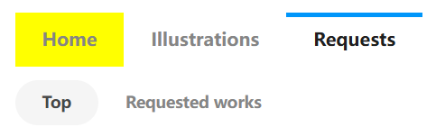

## Crawl request works

<button id="startCrawlRequestWorks" type="button" class="hasRippleAnimation settingsPanelActionBtn" data-btn-emphasis="primary" data-btn-intent="brand" data-xztitle="_抓取约稿作品" title="Crawl request works">Crawl request works</button>

This button is used in the "Requests" category on the user's profile page, for example:

[koro22's request page](https://www.pixiv.net/users/42787448/request)

Tips:
- Works on the request page are loaded by scrolling without pagination, so the crawl count is measured in works. You can set the crawl count in "How many works to crawl".
- The request page shows the requests the user has received by default, and also shows the requests the user has sent (the "Requested works" in the image above). Whichever category page you are on, the downloader crawls the works in that category.
