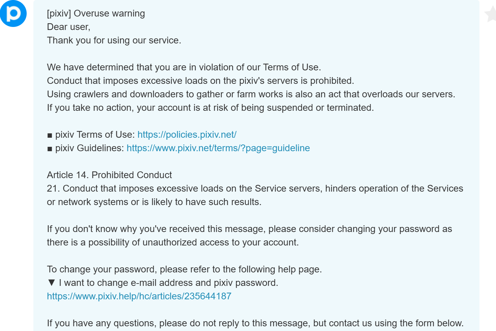
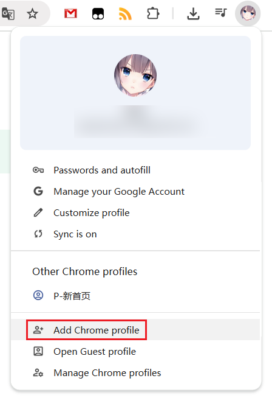
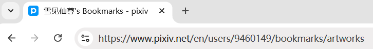
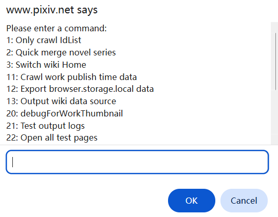

# Risk of Account Ban

## Causes

Because Pixiv limits request frequency, continuously sending a large number of requests with the downloader may result in your Pixiv account being warned or banned.

The following actions may pose a risk:
- Crawling a large number of works
- Downloading a large number of files
- Adding many bookmarks in batches
- Following many users in batches

?> Based on current experience, downloading a few hundred works per day usually won't trigger a warning.

## Pixiv's Handling Method

If you frequently download large amounts of files, such as thousands or tens of thousands of works per day, Pixiv may warn you. When the first warning is triggered, you will receive an in-site message, which may look like this:

During large downloads, the downloader checks every 100 files saved whether you have received such an in-site message. If you have received such an in-site message within the last 1 hour, the downloader will pause the download to avoid making the situation worse.

If your account receives a second warning, there may be different situations:
- If the first warning was several years ago, the second warning may just be a reminder with no actual effect. For example, if you were warned once in 2022 and warned a second time in 2025, the account functions may not be restricted at all.
- However, if the time between the two warnings is relatively short (I don't know the specific threshold), your account may face the following two situations:
  - Milder action: Your account is frozen, and you cannot follow users or bookmark works, but other functions are normal (you can browse, crawl, and download normally). If you encounter this, you can try emailing customer service to request an unban, and your account may be restored.
  - Severe action: Your account will be deleted, you will not be able to log in or request an unban. Since your account no longer exists, other users also cannot view your profile, bookmarks, or other content.

In previous years, Pixiv often used the milder action, but recently it often deletes accounts, indicating that Pixiv has strengthened its handling of violations.

!> If your account is banned, I am not responsible for it. However, the downloader also has some settings to slow down crawling and downloading, which can reduce the risk of being banned.

## How to Reduce Risk

Many people often ask me: How many works can I download per day without getting a warning? In fact, there is no fixed number, because the conditions for triggering a warning depend not only on the number of works, but also on the request frequency.

If the request frequency is very high, downloading a few hundred works may trigger a warning. Conversely, if the request frequency is lowered, downloading a few thousand works may not trigger a warning.

When you need to crawl and download more than a few thousand works, there are some methods to reduce risk:

### Slow Down

The downloader has settings to reduce the likelihood of warnings:
- By default, the downloader [slows down crawling](/en/Settings-Crawl/Execution-strategy?id=slow-down-crawl). When crawling many works, it sends requests at intervals.
- When downloading many files, you can set the [Download interval](/en/Settings-Download/Download-behavior?id=download-interval) to reduce download frequency.

The above two settings both allow you to customize the interval. If you only crawl and download a few hundred works per day, the default interval is usually safe.

The more files you need to crawl and download, the larger the interval you should set. In extreme cases, you can consider setting an interval of about 4 seconds (of course, this will increase the time needed to complete the task).

### Batch Downloading

Assume you want to download all your bookmarks, which may span hundreds of pages or more. You can split the task into multiple sessions, crawling 50 or 100 pages at a time.

See details: [Batch crawling and downloading (Split tasks)](/en/Usage-Tips?id=batch-crawling-and-downloading-split-tasks).

### Using a Secondary Account

If you frequently download large amounts of files, the above settings cannot completely guarantee safety. You can use a secondary account for downloading. Use the main account only for downloading small amounts of files during daily browsing, and use the secondary account specifically for large downloads in conjunction with the methods above.

?> A secondary account can crawl the main account's public bookmarks and followed users as long as you open the corresponding URL. Therefore, you can continue using the main account to follow users and bookmark works normally, and use the secondary account for downloading when needed.

#### Registering a Secondary Account

You can use multiple email addresses to register multiple accounts.

#### Using a Secondary Account in a Separate Environment

You can use multiple browsers, such as Chrome for the main account and Edge for the secondary account.

However, I recommend using a single browser because it is more convenient.

Click the profile icon in the top-right corner of the browser to create a new profile (local browser user). For example, in Chrome, you can add a new profile from here:

When you use the newly added browser profile, Chrome opens a separate browser window where you can log in to the secondary account and install this extension for use.

#### How to Download Data from the Main Account

If you want to download the main account's followed users or bookmarks, first use the main account to navigate to the corresponding page, then copy the URL from the address bar, for example:

In the secondary account's browser, paste the URL and press Enter to access the main account's corresponding page for crawling and downloading.

However, this method only works for the main account's **public** followed users and bookmarks. If you plan to use a secondary account to download the main account's data, make this data public.

## What to Do If Your Account Is Banned During Downloading

If your account is banned during downloading and some files remain undownloaded, you can do the following:

First, do not click the "Stop Download" button. This allows you to restore download progress using the downloader's resume function. Then follow these steps in order:

- Copy the current page's URL from the browser's address bar.
- Log in to another Pixiv account in the **same** browser window.
- Refresh the page that was being downloaded, or paste the URL in the address bar to open the page.
- The downloader should restore the task progress, allowing you to continue downloading.

This works because the downloader has a [resume function](/en/FAQ?id=does-it-support-resumable-downloads), which can restore an unfinished download task at the same URL.

----------

If you already clicked the "Stop Download" button, click the "Export Crawl Results" button to export the crawl results (JSON file) for this task.

After logging in to a new Pixiv account, you can import the crawl results to download these files again.

See details: [Export results](/en/Buttons-Download-area/Crawl-results?id=export-results)

## How to Export Your Following List After Your Account Is Banned

When your account is working normally, you can export (back up) your following list as follows:

Go to your following page, open the downloader panel, and click the [Export followed users list (JSON)](/en/Buttons-Extra-features/Following-page?id=export-followed-users-list-json) button in the "Extra features" area.

You can choose to export in CSV or JSON format, or export both. To restore your following list in the future, you need to use the JSON format.

--------

If your account has already been banned but you did not back up your following list beforehand, you can retrieve it from the downloader's cache.

Open a Pixiv page, then type the command `ppdtask` directly on the keyboard.

?> Tip: You do not need to place the cursor in any input field. After opening the page, press the keys `ppdtask` in sequence.

The downloader will then display a command list, as shown below:

Enter `12` in the input field at the bottom and click the Confirm button. The downloader will export a JSON file named `Powerful Pixiv Downloader browser.storage.local.json`. This file contains the settings and following list data saved internally by the downloader.

Open this JSON file with a code editor. The `following` array contains your following list, as shown below:

Note: If you have logged in to multiple Pixiv accounts in this browser, the downloader may have saved following lists for multiple accounts. You can distinguish them by `user` (your user ID) and `total` (the total number of followed users).

Both the `followedUsersInfo` and `following` arrays can be used to restore your following list. You can choose either one. Using `following` as an example, select its contents (from `[` to `]`, excluding the final comma `,`):

Then copy the selected content, create a new file, paste it, and save it as a file with the `.json` extension. You may choose any file name. This is your following list.

If you do not have a code editor, you can also try asking an AI to extract the data for you.

To restore the following list in a new account:
- Log in to the new account.
- Go to the following page.
- Click the [Follow users in batches (JSON)](/en/Buttons-Extra-features/Following-page?id=follow-users-in-batches-json) button in "Extra features" and select the JSON file you just saved.
