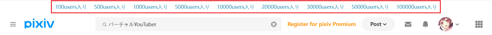

## Add a quick search area on the search page

<div class="option settingsPanel_optionCard" data-no="90" data-pin-bound="true" style="display: flex;">
  <a href="/#/en/Settings-Enhance/Search-page?flag=90" target="_blank" class="settingNameStyle" data-bind-click="true">
    <span data-xztext="_在搜索页面添加快捷搜索区域">Add a quick <span class="key">search</span> area on the search page</span>
  </a>
  <input type="checkbox" name="showFastSearchArea" class="need_beautify checkbox_switch" checked="">
  <span class="beautify_switch" tabindex="0"></span>
</div>

The downloader adds buttons for specific bookmark counts at the top of search pages, for example:



Clicking these buttons adds the bookmark count tag to the current search and performs the search.

For example, on the `バーチャルYouTuber` page, clicking the `10000users入り` button makes the downloader search for `バーチャルYouTuber 10000users入り`.

?> This feature is particularly useful for non-Pixiv premium users.

?> This feature is not always accurate. Some users may add the `10000users入り` tag to works with low bookmark counts, which is deceptive.

The bookmark count buttons added by the downloader are:

```
100users入り 500users入り 1000users入り 5000users入り 10000users入り 20000users入り 30000users入り 50000users入り 100000users入り
```

## Filter works on the search page

<div class="option settingsPanel_optionCard" data-no="91" data-pin-bound="true" style="display: flex;">
  <a href="/#/en/Settings-Enhance/Search-page?flag=91" target="_blank" class="settingNameStyle" data-bind-click="true">
    <span data-xztext="_筛选搜索页面的作品"><span class="key">Filter</span> works on the search page</span>
  </a>
  <input type="checkbox" name="filterSearchResults" class="need_beautify checkbox_switch">
  <span class="beautify_switch" tabindex="0"></span>
</div>

*The description of this setting is exactly the same as the description in the downloader.*

After you enable this feature, the downloader will intercept Pixiv's requests on the search page and apply the filter conditions before the works are displayed, removing works that do not meet the conditions. This way, only works that meet the conditions will be displayed.

**Notes:**

- After you enable this feature or modify the filter conditions, the works displayed on the page will not change; this is normal because they have already been displayed. This feature is implemented by intercepting requests, so subsequent requests will apply your changes. Therefore, you can see the effect of the changes when you turn the page or refresh.

- Since the work list data does not include the bookmark count, the downloader cannot use the bookmark count to filter works. The bookmark count condition will be ignored.

- When enabling this feature, please use the "Image Color" filter with caution. If only one color is selected (which means judging the color of the image), the downloader needs to load thumbnails of all works to determine the color, which will generate a large number of requests and also take more time.

## Remove the works of followed users from the search page

<div class="option settingsPanel_optionCard" data-no="92" data-pin-bound="true" style="display: flex;">
  <a href="/#/en/Settings-Enhance/Search-page?flag=92" target="_blank" class="settingNameStyle" data-bind-click="true">
    <span data-xztext="_在搜索页面里移除已关注用户的作品"><span class="key">Remove</span> the works of followed users from the search page</span>
  </a>
  <input type="checkbox" name="removeWorksOfFollowedUsersOnSearchPage" class="need_beautify checkbox_switch">
  <span class="beautify_switch" tabindex="0"></span>
</div>

If enabled, the downloader removes works by followed users when you're on a search page.

This helps you focus on works from unfollowed users when discovering new artists, reducing distractions and improving efficiency.

?> This feature does not affect crawl results. Even if works by followed users are removed, the downloader will still crawl them.
