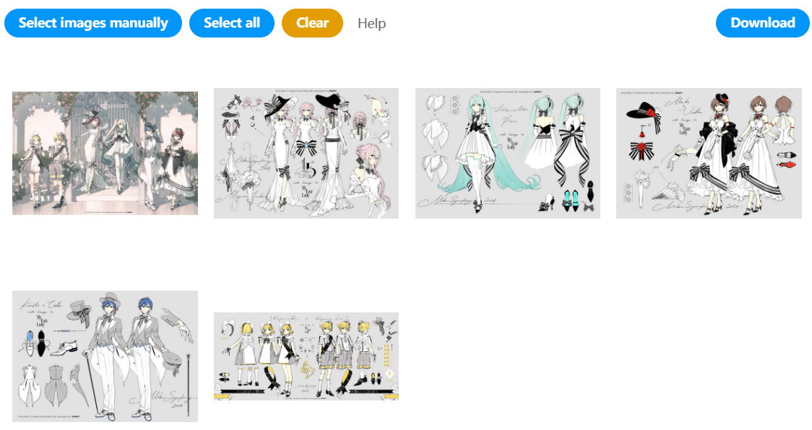
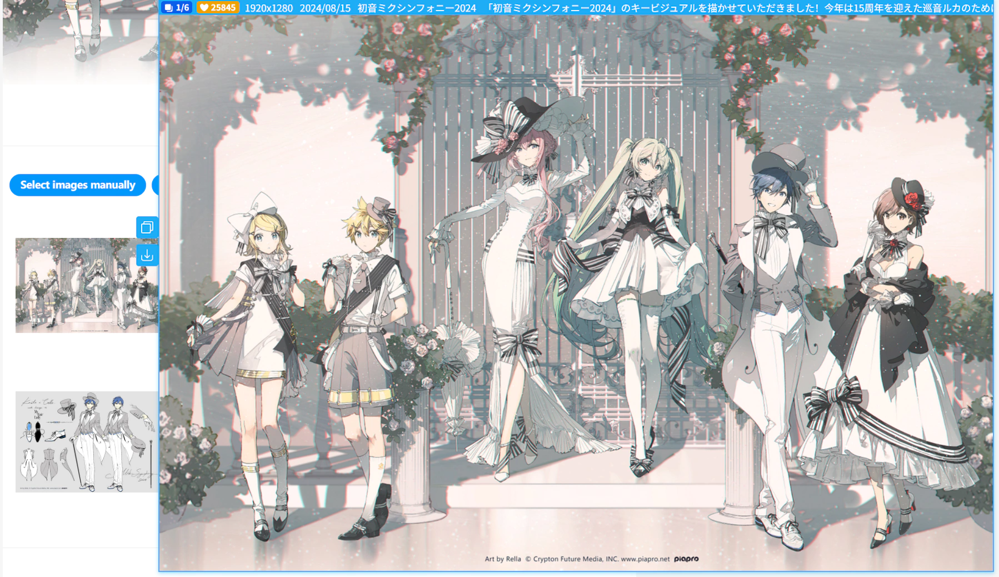

## Show larger thumbnails

  <a href="/#/en/Settings-Enhance/Thumbnails?flag=78" target="_blank" class="settingNameStyle" data-bind-click="true">
    Show larger thumbnails
  </a>
  <input type="checkbox" name="showLargerThumbnails" class="need_beautify checkbox_switch">
  

The work thumbnails on Pixiv are relatively small; the display size of most thumbnails is usually 184 px. This is a screenshot of the default state:

Because the thumbnails are small and the details cannot be seen clearly, I often need to click into a work to view the large image to know whether I like it. Also, looking at them for a long time is tiring for the eyes.

After enabling this feature, the downloader increases the width of the work list container and makes the thumbnails display at their original size, so that larger thumbnails can be shown.

?> Depending on the original size of the thumbnails, their display size may become 250 px, 360 px or 540 px.

If the "Replace square thumbnails to show the image ratio" feature below is enabled, the thumbnail size is fixed at 540 px, and the effect is as follows:

In this way you can see them more clearly, and your eyes will be more relaxed and less tired.

?> Depending on the screen resolution and DPI scaling, the number of images displayed in a row also differs.

?> This feature is not very stable, because updates to the Pixiv code may cause this feature to stop working on some pages.

## Replace square thumbnails to show image ratio

  <a href="/#/en/Settings-Enhance/Thumbnails?flag=79" target="_blank" class="settingNameStyle" data-bind-click="true">
    Replace square thumbnails to show image ratio
  </a>
  <input type="checkbox" name="replaceSquareThumb" class="need_beautify checkbox_switch" checked="">
  

Pixiv's thumbnails are 250 px square images, making it impossible to see the image's aspect ratio (horizontal or vertical) or its full content, as edges are cropped. For example:

Enabling this feature replaces square thumbnails with 540 px thumbnails, showing the image's original aspect ratio and full content. For example:

## Show thumbnail list on multi-image work pages

  <a href="/#/en/Settings-Enhance/Thumbnails?flag=80" target="_blank" class="settingNameStyle" data-bind-click="true">
    Show thumbnail list on multi-image work pages
  </a>
  <input type="checkbox" name="displayThumbnailListOnMultiImageWorkPage" class="need_beautify checkbox_switch" checked="">
  

When on a **multi-image work** page (e.g., [121525173](https://www.pixiv.net/artworks/121525173)), the downloader can display thumbnails for each image. For example:

You can preview or download each image.

### Select some images to download

Some buttons are displayed at the top of the thumbnail list. If you only need to download some images of this work, you can use these buttons.

Click the `Manually select images` button to enter/exit manual selection mode. In manual selection mode, click an image to select it; click it again to deselect it.

After you finish selecting, click the `Download` button on the right side of this area to download the selected images.

?> Tip: If you click the `Download` button without selecting any images, the downloader will download all images.

### Enhanced features

When hovering over a thumbnail, you can use enhancement features, such as:

These features include:
- Copy button (click it to copy the work info)
- Download button (clicking this button downloads only the image it belongs to)
- Preview work (you can still use shortcuts `C` to download a single image or `D` to download the entire work)
- View full image by long-pressing the right mouse button
- Clicking a thumbnail opens the image viewer, for example:

## Display images in grayscale

  <a href="/#/en/Settings-Enhance/Thumbnails?flag=81" target="_blank" class="settingNameStyle" data-bind-click="true">
    Display images in grayscale
  </a>
  <input type="checkbox" name="imageToGray" class="need_beautify checkbox_switch">
  

This is a hidden setting.
