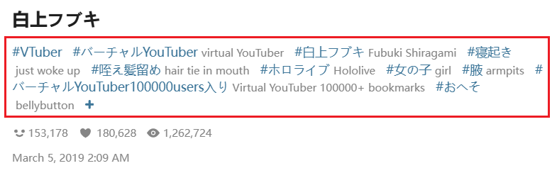

## Tags must contain

  <a href="/#/en/Settings-Filter/Tags-and-title?flag=15" target="_blank" class="settingNameStyle" data-bind-click="true">
    Tags must contain
  </a>
  <input type="checkbox" name="needTagSwitch" class="need_beautify checkbox_switch">
  

  

    Match mode: 
    <input type="radio" name="needTagMode" id="needTagMode1" class="need_beautify radio" value="all" checked="">
    
    <label for="needTagMode1" data-xztext="_全部" class="active">All</label>
    <input type="radio" name="needTagMode" id="needTagMode2" class="need_beautify radio" value="one">
    
    <label for="needTagMode2" data-xztext="_任一">One</label>
    <textarea class="centerPanelTextArea beautify_scrollbar" name="needTag" rows="1" placeholder="tag1,tag2,tag3"></textarea>
  

You can require works to contain certain tags. Works without these tags will not be crawled.

?> Tags refer to the tag list below the work's description, for example:

**Tip:**
- You can add multiple tags, separated by **English commas** `,`.
- Case insensitive.
- Whole word matching. If you set `ab`, it will only match `ab`, not `abc`. And vice versa.
- Matching mode: `All` means the work must contain all the tags you set; `Any` means the work only needs to contain any one of the tags you set.
- The downloader checks both the original tags and the translated tags together. If the original tags do not contain the tag you set, but the translated tags do, the downloader will consider that the work contains this tag.
- Depending on the language you use on Pixiv, Pixiv will return different translated tags. For example, the English translation of `巨乳` is `large breasts`, and the Korean translation is `거유`. Therefore, when the downloader checks translated tags, it will only check the translated tags in the current language.
- It is recommended to use original tags.

## Tags must not contain

  <a href="/#/en/Settings-Filter/Tags-and-title?flag=16" target="_blank" class="settingNameStyle" data-bind-click="true">
    Tags must not contain
  </a>
  <input type="checkbox" name="notNeedTagSwitch" class="need_beautify checkbox_switch">
  

  

    

      <label for="notNeedTagWholeSwitch">
        Use exact match tags
      </label>
      <input type="checkbox" name="notNeedTagWholeSwitch" id="notNeedTagWholeSwitch" class="need_beautify checkbox_switch">
      
      

        <textarea class="centerPanelTextArea beautify_scrollbar" name="notNeedTagWhole" rows="1" placeholder="tag1,tag2,tag3"></textarea>
      

    

    

      <label for="notNeedTagPartialSwitch">
        Use partial match tags
      </label>
      <input type="checkbox" name="notNeedTagPartialSwitch" id="notNeedTagPartialSwitch" class="need_beautify checkbox_switch">
      
      

        <textarea class="centerPanelTextArea beautify_scrollbar" name="notNeedTagPartial" rows="1" placeholder="tag1,tag2,tag3"></textarea>
      

    

  

You can require works to not contain certain tags. If a work has **any one** of the tags set here, the downloader will not crawl it.

This setting works similarly to `Include tag`, with the differences:
- Match mode is always `One`: if you set multiple tags, a work containing **any one** of them will be excluded (not downloaded).
- Optional `Perfect match` or `Partial match`: the default `Perfect match` is whole-word matching. `Partial match` allows substring matching — in `Partial match` your `ab` can match a work tag `abc`, but your `abc` will not match a work tag `ab` (i.e., the tag you set cannot be longer than the target tag).
- Higher priority: `Exclude tag` has higher priority than `Include tag`. If a work matches both settings, the downloader will exclude it (i.e., it will not be crawled or downloaded).

## Block tags for specific users

  <a href="/#/en/Settings-Filter/Tags-and-title?flag=17" target="_blank" class="settingNameStyle" data-bind-click="true">
    Block tags for specific users
  </a>
  <input type="checkbox" name="blockTagsForSpecificUser" class="need_beautify checkbox_switch">
  

  

    <slot data-name="blockTagsForSpecificUser">

    

      0
      <button type="button" class="textButton expand" data-xztext="_收起">Collapse</button>
      <button type="button" class="textButton showAdd" data-xztext="_添加">Add</button>
    

    

      

        

          User ID (Number)
          <input type="text" class="setinput_style blue addUidInput" data-xzplaceholder="_必须是数字" placeholder="Number">
        

        

          Tags
          <input type="text" class="setinput_style blue addTagsInput" data-xzplaceholder="_tag用逗号分割" placeholder="Multiple tags use comma (,) split">
        

        

          <button type="button" class="textButton add" data-xztitle="_添加" title="Add">
            <svg class="icon" aria-hidden="true">
              <use xlink:href="#yes_submit"></use>
            </svg>
          </button>
          
          <button type="button" class="textButton cancel" data-xztitle="_取消" title="Cancel">
            <svg class="icon" aria-hidden="true">
              <use xlink:href="#close_cancel"></use>
            </svg>
          </button>
        

      

    

    

    

  
</slot>
  

If you don't like certain works from a specific user and don't want the downloader to crawl or download them, you can enable this setting.

You can enter a user ID and specific tags from their works. When the downloader crawls works from this user, it will skip works containing these tags.

For example, you can set to exclude `tag1,tag2,tag3` from user ID `123456`.

## Title must contain

  <a href="/#/en/Settings-Filter/Tags-and-title?flag=18" target="_blank" class="settingNameStyle" data-bind-click="true">
    Title must contain
  </a>
  <input type="checkbox" name="titleIncludeSwitch" class="need_beautify checkbox_switch">
  

  

    <textarea class="centerPanelTextArea beautify_scrollbar" name="titleIncludeList" rows="1" placeholder="word1,word2,word3"></textarea>
  

You can require that the work's title must contain specific characters. After enabling this setting, if the work's title does not contain the required characters, the downloader will not crawl it.

- Case insensitive.
- You can set multiple character strings, separated by commas (,).
- The matching mode is "Any", meaning as long as the title contains any one of the specified character strings, the downloader will crawl it.

## Title must not contain

  <a href="/#/en/Settings-Filter/Tags-and-title?flag=19" target="_blank" class="settingNameStyle" data-bind-click="true">
    Title must not contain
  </a>
  <input type="checkbox" name="titleExcludeSwitch" class="need_beautify checkbox_switch">
  

  

    <textarea class="centerPanelTextArea beautify_scrollbar" name="titleExcludeList" rows="1" placeholder="word1,word2,word3"></textarea>
    <label for="alsoCheckSeriesTitle" data-xztext="_也检查系列标题" class="active">Also check series title</label>
    <input type="checkbox" name="alsoCheckSeriesTitle" id="alsoCheckSeriesTitle" class="need_beautify checkbox_switch" checked="">
    
  

You can require that the work's title must not contain specific characters. After enabling this setting, if the work's title contains any of the characters specified here, the downloader will not crawl it.

- Case insensitive.
- You can set multiple character strings, separated by commas (,).
- The matching mode is "Any", meaning as long as the title contains any one of the specified character strings, the downloader will not crawl it.
- Exclusion has higher priority than inclusion. Once a work is excluded by this filter, the downloader will not crawl it, even if it meets other conditions.

**Sub-option:**
- `Also check series title`: When enabled, the downloader will also check the series title. If a work belongs to a series (for example, a manga series or a novel series) and the series title contains any excluded strings, the downloader will exclude that work and will not download the series.
