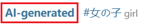
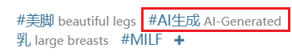
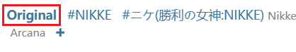
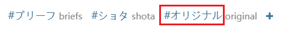

## Type of work

<div class="option settingsPanel_optionCard" data-no="3" data-pin-bound="true" style="display: flex;">
  <a href="/#/en/Settings-Filter/Work-type?flag=3" target="_blank" class="settingNameStyle" data-bind-click="true">
    <span data-xztext="_作品类型"><span class="key">Type</span> of work</span>
  </a>
  <input type="checkbox" name="downType0" id="setWorkType0" class="need_beautify checkbox_common" checked="">
  <span class="beautify_checkbox" tabindex="0" aria-labelledby="setWorkType0"></span>
  <label for="setWorkType0" data-xztext="_插画" class="active">Illustrations</label>
  <input type="checkbox" name="downType1" id="setWorkType1" class="need_beautify checkbox_common" checked="">
  <span class="beautify_checkbox" tabindex="0" data-xztitle="_漫画" title="Manga"></span>
  <label for="setWorkType1" data-xztext="_漫画" class="active">Manga</label>
  <input type="checkbox" name="downType2" id="setWorkType2" class="need_beautify checkbox_common" checked="">
  <span class="beautify_checkbox" tabindex="0"></span>
  <label for="setWorkType2" data-xztext="_动图" class="active">Ugoira</label>
  <input type="checkbox" name="downType3" id="setWorkType3" class="need_beautify checkbox_common" checked="">
  <span class="beautify_checkbox" tabindex="0"></span>
  <label for="setWorkType3" data-xztext="_小说" class="active">Novels</label>
</div>

This setting allows you to filter the types of works you want to download.

The downloader checks the type of each work during crawling and excludes those that do not meet the criteria.

## Age restriction

<div class="option settingsPanel_optionCard" data-no="4" data-pin-bound="true" style="display: flex;">
  <a href="/#/en/Settings-Filter/Work-type?flag=4" target="_blank" class="settingNameStyle" data-bind-click="true">
    <span data-xztext="_年龄限制"><span class="key">Age</span> restriction</span>
  </a>
  <input type="checkbox" name="downAllAges" id="downAllAges" class="need_beautify checkbox_common" checked="">
  <span class="beautify_checkbox" tabindex="0"></span>
  <label for="downAllAges" data-xztext="_全年龄" class="active">All ages</label>
  <input type="checkbox" name="downR18" id="downR18" class="need_beautify checkbox_common" checked="">
  <span class="beautify_checkbox" tabindex="0"></span>
  <label for="downR18" class="active"> R-18</label>
  <input type="checkbox" name="downR18G" id="downR18G" class="need_beautify checkbox_common" checked="">
  <span class="beautify_checkbox" tabindex="0"></span>
  <label for="downR18G" class="active"> R-18G</label>
</div>

You can filter works based on their age restriction.

The downloader checks the age restriction of each work during crawling and excludes those that do not meet the criteria.

## AI works

<div class="option settingsPanel_optionCard" data-no="5" data-pin-bound="true" style="display: flex;">
  <a href="/#/en/Settings-Filter/Work-type?flag=5" target="_blank" class="settingNameStyle" data-bind-click="true">
    <span data-xztext="_AI作品带高亮"><span class="key">AI</span> works</span>
  </a>
  <input type="checkbox" name="AIGenerated" id="AIGenerated" class="need_beautify checkbox_common" checked="">
  <span class="beautify_checkbox" tabindex="0"></span>
  <label for="AIGenerated" data-xztext="_AI生成" class="active">AI-generated</label>
  <input type="checkbox" name="notAIGenerated" id="notAIGenerated" class="need_beautify checkbox_common" checked="">
  <span class="beautify_checkbox" tabindex="0"></span>
  <label for="notAIGenerated" data-xztext="_非AI生成" class="active">Not AI-generated</label>
  <input type="checkbox" name="UnknownAI" id="UnknownAI" class="need_beautify checkbox_common" checked="">
  <span class="beautify_checkbox" tabindex="0"></span>
  <label for="UnknownAI" data-xztext="_未知" class="has_tip active" data-xztip="_AI未知作品的说明" data-tip="Early works are not marked and cannot be judged">Unknown</label>
</div>

You can filter works based on whether they are AI-generated.

The downloader checks the AI tag of each work during crawling and excludes those that do not meet the criteria.

--------

When users submit works, illustrations, manga, and Ugoira must select whether they are AI-generated, while novels have the option to select whether they are AI-generated. Therefore, the downloader can determine whether these works are AI-generated.

If the user selects that the work is AI-generated, Pixiv will display the bolded text "AI-generated" at the beginning of the tag list, for example:



If there is no bold "AI-generated", it means the user has set the work as "non-AI-generated".

The `Unknown` type applies to early works. Because AI image generation technology was not widely available in the early days, Pixiv did not require works to add this mark at that time, so the downloader cannot determine whether they are AI-generated. Generally, you can treat `Unknown` works as non-AI-generated.

**Additional Processing:**

Since many users deliberately set AI-generated images as "non-AI-generated" to evade moderation, the downloader will check the work's tags. If it contains specific tags, it will treat the work as AI-generated. For example:



These tags are:

```
AI生成,AI-generated,AIイラスト,AI生成作品,AI 画作,AI生成イラスト,AI 생성,сгенерированный ИИ,สร้างโดย AI,Janaan AI
```

However, some users deliberately do not add any AI-related tags. In this case, the downloader cannot determine whether it is an AI-generated work based on the tags.

## Bookmark status

<div class="option settingsPanel_optionCard" data-no="9" data-pin-bound="true" style="display: flex;">
  <a href="/#/en/Settings-Filter/Work-type?flag=9" target="_blank" class="settingNameStyle" data-bind-click="true">
    <span data-xztext="_收藏状态"><span class="key">Bookmark</span> status</span>
  </a>
  <input type="checkbox" name="downNotBookmarked" id="setDownNotBookmarked" class="need_beautify checkbox_common" checked="">
  <span class="beautify_checkbox" tabindex="0"></span>
  <label for="setDownNotBookmarked" data-xztext="_未收藏" class="active">Not bookmarked</label>
  <input type="checkbox" name="downBookmarked" id="setDownBookmarked" class="need_beautify checkbox_common" checked="">
  <span class="beautify_checkbox" tabindex="0"></span>
  <label for="setDownBookmarked" data-xztext="_已收藏" class="active">Bookmarked</label>
</div>

You can filter works based on their bookmark status.

The downloader checks whether each work is bookmarked by you during crawling and excludes those that do not meet the criteria.

## Original works

<div class="option settingsPanel_optionCard" data-no="6" data-pin-bound="true" style="display: flex;">
  <a href="/#/en/Settings-Filter/Work-type?flag=6" target="_blank" class="settingNameStyle" data-bind-click="true">
    <span data-xztext="_原创作品"><span class="key">Original</span> works</span>
  </a>
  <input type="checkbox" name="crawlOriginalWork" id="setCrawlOriginalWork" class="need_beautify checkbox_common" checked="">
  <span class="beautify_checkbox" tabindex="0"></span>
  <label for="setCrawlOriginalWork" data-xztext="_原创" class="active">Original</label>
  <input type="checkbox" name="crawlNonOriginalWork" id="setCrawlNonOriginalWork" class="need_beautify checkbox_common" checked="">
  <span class="beautify_checkbox" tabindex="0"></span>
  <label for="setCrawlNonOriginalWork" data-xztext="_非原创" class="active">Non-original</label>
  <span class="verticalSplit"></span>
  <input type="checkbox" name="looseMatchOriginal" id="looseMatchOriginal" class="need_beautify checkbox_common" checked="">
  <span class="beautify_checkbox" tabindex="0"></span>
  <label for="looseMatchOriginal" data-xztext="_宽松匹配" class="active">Loose matching</label>
</div>

You can filter original works and non-original works.

**How it works:**

When artists submit a work, they can set whether it is an original work. This becomes a property of the work (`isOriginal`).

For original works, Pixiv displays the bolded word "Original" at the beginning of the tag list, for example:



If it is not an original work, there will be no bold "Original" text. Even if it contains tags related to originality, it is **not** considered an original work, for example:



The downloader first checks the work's `isOriginal` property to determine whether it is an original work. If `isOriginal` is `true`, it is an original work; otherwise, it is a non-original work.

Additionally, the downloader enables the `Loose matching` rule by default: for non-original works, if it contains any of the specific tags, the downloader will treat it as an original work when checking this filter condition. These tags are:

```
原创,原創,創作,オリジナル,Original,original,Creation,creation,창작,오리지널,Asli,ออริจินัล,Оригинал
```

PS: If you disable the `Loose matching` rule, the downloader will not check the tag list, so non-original works will never be treated as original works.

## From users

<div class="option settingsPanel_optionCard new" data-no="114" data-pin-bound="true" style="display: flex;">
  <a href="/#/en/Settings-Filter/Work-type?flag=114" target="_blank" class="settingNameStyle" data-bind-click="true">
    <span data-xztext="_来自用户带高亮">From <span class="key">users</span></span>
  </a>
  <input type="checkbox" name="crawlFollowedUsers" id="setCrawlFollowedUsers" class="need_beautify checkbox_common" checked="">
  <span class="beautify_checkbox" tabindex="0"></span>
  <label for="setCrawlFollowedUsers" data-xztext="_已关注的用户" class="active">Followed users</label>
  <input type="checkbox" name="crawlNonFollowedUsers" id="setCrawlNonFollowedUsers" class="need_beautify checkbox_common" checked="">
  <span class="beautify_checkbox" tabindex="0"></span>
  <label for="setCrawlNonFollowedUsers" data-xztext="_未关注的用户" class="active">Users you don't follow</label>
  <span class="settingsPanel_newBadge" aria-hidden="true">
    <svg class="icon settingsPanel_newBadgeIcon" aria-hidden="true">
      <use xlink:href="#new"></use>
    </svg>
  </span>
</div>

With this setting, you can download only works from users you follow, or only works from users you don't follow.

## Number of images

<div class="option settingsPanel_optionCard" data-no="8" data-pin-bound="true" style="display: flex;">
  <a href="/#/en/Settings-Filter/Work-type?flag=8" target="_blank" class="settingNameStyle" data-bind-click="true">
    <span data-xztext="_图片数量"><span class="key">Number</span> of images</span>
  </a>
  <input type="checkbox" name="downSingleImg" id="setDownSingleImg" class="need_beautify checkbox_common" checked="">
  <span class="beautify_checkbox" tabindex="0"></span>
  <label for="setDownSingleImg" data-xztext="_单图作品" class="active">Single image works</label>
  <input type="checkbox" name="downMultiImg" id="setDownMultiImg" class="need_beautify checkbox_common" checked="">
  <span class="beautify_checkbox" tabindex="0"></span>
  <label for="setDownMultiImg" data-xztext="_多图作品" class="active">Multi-image works</label>
</div>

You can filter works based on the number of images.

The downloader checks this setting during crawling and excludes works that do not meet the criteria.

Single-image works have only one image; multi-image works contain multiple images, often marked in the top-right corner, for example:


## Image color

<div class="option settingsPanel_optionCard" data-no="7" data-pin-bound="true" style="display: flex;">
  <a href="/#/en/Settings-Filter/Work-type?flag=7" target="_blank" class="settingNameStyle" data-bind-click="true">
    <span data-xztext="_图片色彩">Image <span class="key">color</span></span>
  </a>
  <input type="checkbox" name="downColorImg" id="setDownColorImg" class="need_beautify checkbox_common" checked="">
  <span class="beautify_checkbox" tabindex="0"></span>
  <label for="setDownColorImg" data-xztext="_彩色图片" class="active">Color images</label>
  <input type="checkbox" name="downBlackWhiteImg" id="setDownBlackWhiteImg" class="need_beautify checkbox_common" checked="">
  <span class="beautify_checkbox" tabindex="0"></span>
  <label for="setDownBlackWhiteImg" data-xztext="_黑白图片" class="active">Black and white images</label>
  <span class="verticalSplit"></span>
  <span data-xztext="_彩色占比阈值">Color ratio threshold</span>
  <input type="text" name="coloredRatio" class="setinput_style blue w50" value="25">
  <span>%</span>
</div>

You can filter works by the color of the images. A common use case is excluding black-and-white manga images.

If you set it to filter color or black-and-white images, the filter checks the colors of the image to determine whether the image is in color or black-and-white. The downloader checks this setting both when crawling and when downloading.

**How it works:**

When checking the colors of an image, the downloader ignores white and transparent pixels, and only counts color, gray and black pixels. This is because when the human eye judges whether an image is in color, it usually does not care about the white areas; the focus is on whether the other content is in color. After removing the white areas, the accuracy is higher.

Then the downloader calculates the ratio of color pixels and compares it with the "Color Ratio Threshold": if the ratio of color pixels in an image is greater than the threshold, the image is treated as a color image; otherwise it is treated as a black-and-white image.

**Color ratio threshold:**

In some images, color, gray and black may each occupy a certain proportion.

- If you **increase** the color ratio threshold, images are more likely to be treated as black-and-white images.
- If you **decrease** the color ratio threshold, images are more likely to be treated as color images.

Rough reference data when the threshold is 25%:

- When crawling illustrations and Ugoira, about 10% - 20% of images are treated as black-and-white images.
- When crawling manga, about 50% of images are treated as black-and-white images.

?> Some images are mostly black-and-white but still have some color (the color area can sometimes even reach 30%). Such images are color images, not black-and-white images. Also, if the lines of a black-and-white image are colored, or it uses a lighter background color, it may also be treated as a color image.

?> By comparison, the downloader rarely misjudges a color image as a black-and-white image, unless the proportion of gray and black is indeed very high.

**When it is checked:**

- If you have not excluded images of a certain color, the downloader will not check the image colors.
- If you have excluded images of a certain color, the downloader checks them both when crawling and when downloading. During the crawling stage, the downloader loads the thumbnails of the images to check them; if an image does not meet the requirements, it will not be saved. During the downloading stage, the downloader checks the color of the image again after downloading it; if it does not meet the requirements, it will not be saved to the disk.

When downloading, if a file is excluded because of its color, a message will be shown in the log. For example:

<span class="log" style="color: rgb(210, 126, 0);"><a href="https://www.pixiv.net/i/134469561#1" target="_blank">134469561_p0</a> was not saved because its color does not meet the settings.<br></span>

## Image format

<div class="option settingsPanel_optionCard new" data-no="112" data-pin-bound="true" style="display: flex;">
  <a href="/#/en/Settings-Filter/Work-type?flag=112" target="_blank" class="settingNameStyle" data-bind-click="true">
    <span data-xztext="_图片格式">Image <span class="key">format</span></span>
  </a>
  <input type="checkbox" name="downJPGImg" id="downJPGImg" class="need_beautify checkbox_common" checked="">
  <span class="beautify_checkbox" tabindex="0"></span>
  <label for="downJPGImg" class="active"> .jpg </label>
  <input type="checkbox" name="downPNGImg" id="downPNGImg" class="need_beautify checkbox_common" checked="">
  <span class="beautify_checkbox" tabindex="0"></span>
  <label for="downPNGImg" class="active"> .png </label>
  <span class="settingsPanel_newBadge" aria-hidden="true">
    <svg class="icon settingsPanel_newBadgeIcon" aria-hidden="true">
      <use xlink:href="#new"></use>
    </svg>
  </span>
</div>

*The description of this setting is exactly the same as the description in the downloader.*

You can decide whether to download images in `.jpg` and `.png` format as needed.

Note:

This setting only checks the images in illustrations and manga. It does not check the images in ugoira or novels.
