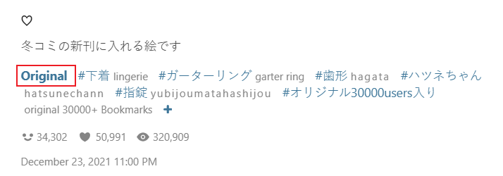
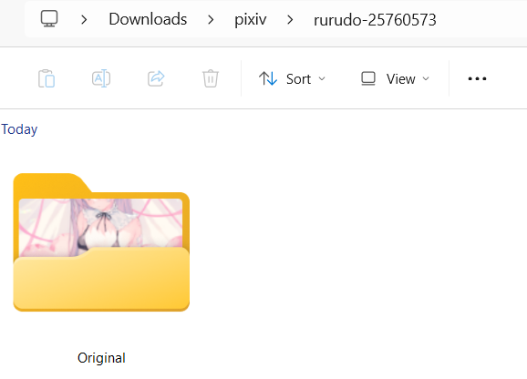

## Do not create folder

<div class="option settingsPanel_optionCard" data-no="40" data-pin-bound="true" style="display: flex;">
  <a href="/#/en/Settings-Naming/Adjust-folders?flag=40" target="_blank" class="settingNameStyle" data-bind-click="true">
    <span data-xztext="_不创建文件夹">Do <span class="key">not create</span> folder</span>
  </a>
  <input type="checkbox" name="noFolderSwitch" class="need_beautify checkbox_switch">
  <span class="beautify_switch" tabindex="0"></span>

  <div class="subOptionWrap noGrow flexBasis100" data-show="noFolderSwitch" style="display: none;">
    <div class="optionLine">
      <input type="checkbox" name="noFolderWhenDownload1Image" id="noFolderWhenDownload1Image" class="need_beautify checkbox_common" checked="">
      <span class="beautify_checkbox" tabindex="0"></span>
      <label for="noFolderWhenDownload1Image" data-xztext="_从插画漫画里下载1张图片时" class="active">When downloading 1 image from an illustration or manga</label>
    </div>
    <div class="optionLine">
      <input type="checkbox" name="noFolderWhenDownloadMultipleImages" id="noFolderWhenDownloadMultipleImages" class="need_beautify checkbox_common">
      <span class="beautify_checkbox" tabindex="0"></span>
      <label for="noFolderWhenDownloadMultipleImages" data-xztext="_从插画漫画里下载多张图片时">When downloading multiple images from an illustration or manga</label>
    </div>
    <div class="optionLine">
      <input type="checkbox" name="noFolderWhenUgoira" id="noFolderWhenUgoira" class="need_beautify checkbox_common" checked="">
      <span class="beautify_checkbox" tabindex="0"></span>
      <label for="noFolderWhenUgoira" data-xztext="_动图" class="active">Ugoira</label>
    </div>
    <div class="optionLine">
      <input type="checkbox" name="noFolderWhenNovel" id="noFolderWhenNovel" class="need_beautify checkbox_common">
      <span class="beautify_checkbox" tabindex="0"></span>
      <label for="noFolderWhenNovel" data-xztext="_小说">Novels</label>
    </div>
  </div>
</div>

*The description of this setting is exactly the same as the description in the downloader.*

After enabling this setting, files that meet the conditions will not have a folder created for them, and will instead be saved directly to the browser's download directory.

Sub-options:

- When downloading 1 image from an illustration or manga: If you download only 1 image from this work, no folder will be created for that image. Each work is counted separately.

- When downloading multiple images from an illustration or manga: If you download multiple images from this work, no folder will be created for those images. Each work is counted separately.

- Ugoira: No folder will be created for Ugoira works.

- Novel: No folder will be created for a single novel work.

Tip:

If you enable all sub-options, then no folders will be created for any works.

This setting does not apply to collection files generated after merging a novel series. If you want collection files to be saved without creating folders, you can change the "Naming rule when merging a novel series" in "Naming / Folder and file names".

## Add a folder layer for multi-image works

<div class="option settingsPanel_optionCard" data-no="41" data-pin-bound="true" style="display: flex;">
  <a href="/#/en/Settings-Naming/Adjust-folders?flag=41" target="_blank" class="settingNameStyle" data-xztext="_为多图作品添加一层文件夹" data-bind-click="true">Add a folder layer for <span class="key">multi-image</span> works</a>
  <input type="checkbox" name="folderForMultiImageWorksSwitch" class="need_beautify checkbox_switch">
  <span class="beautify_switch" tabindex="0"></span>
  <div class="subOptionWrap flexBasis100 namingTipArea" data-show="folderForMultiImageWorksSwitch" style="display: none;">
    <div class="optionLine">
      <label for="folderForMultiImageWorksImageNumber" class="pr0" data-xztext="_当作品里的图片大于指定数量时启用">Enable when the number of images in the work exceeds the specified number: </label>
      <input class="setinput_style blue w50 noGrow" type="text" name="folderForMultiImageWorksImageNumber" id="folderForMultiImageWorksImageNumber" value="1">
    </div>
    <div class="optionLine">
      <label for="folderForMultiImageWorksRule" class="pr0" data-xztext="_要添加的这层文件夹的规则">Rule for the folder layer to add: </label>
      <input class="setinput_style blue w150 grow" type="text" name="folderForMultiImageWorksRule" id="folderForMultiImageWorksRule" value="{pid}" style="min-width: 100px">
    </div>
    <div class="secondary_hint">
      <span data-xztext="_提示还需要添加特定命名规则才能创建文件夹_multi_image_folder">You also need to add <span class="blue name">/{multi_image_folder}/</span> in "Folder and file names" - "Naming rules for image works" to achieve this effect. You can click the "Help" button to see detailed instructions.</span>
    </div>
  </div>
</div>

The downloader can add a separate folder layer for multi-image works. Click the `Help` button for this setting in the downloader panel to view the detailed explanation.

For example, work [79239641](https://www.pixiv.net/artworks/79239641 ':target=_blank') has 3 images. After enabling this feature, you can put those images into a folder named with the work ID, like this:

```
79239641/
  |---- 79239641_p0.jpg
  |---- 79239641_p1.jpg
  |---- 79239641_p2.jpg
```

**Sub-options:**

- `Enable when the number of images in the work exceeds the specified number`: The downloader adds the configured folder only when the number of images in the work is greater than this value. The default is 1, so it applies to all multi-image works. You can set other values if needed.
- `Rule for the folder layer to add`: The name of the folder added for multi-image works. Like the regular naming rule, you can use tags and custom text here, and you can also use `/` to create nested folders. The default value is `{pid}`, which uses the work ID without the page number.

After that, you also need to modify the `Naming rule for image works` setting and insert `/{multi_image_folder}/` where needed to add the folder layer. Example: `pixiv/{user}-{user_id}/{multi_image_folder}/{id}-{title}`

You need to insert this tag manually so you can decide where this folder layer should appear. Usually it is placed before the filename, but some users may want it in a higher-level folder or even inside the filename.

**Tips:**

- If you want to use the work ID in the folder name, do not use `{id}`. Use `{pid}` instead. In a multi-image work, each image has a different `{id}`, so using `{id}` would create a separate folder for each image.
- Although the setting name says `add one folder layer`, you can actually configure multiple nested folders here.
- `{multi_image_folder}` itself does not create a folder unless your folder rule already ends with a slash `/`. So in most cases you need to add `/` after it. But this can also be useful: if you do not want to create a folder and only want to mark multi-image works in the filename, you can use it in the filename directly. For example, if the folder rule is `multi-image` and you add it to the filename like `pixiv/{user}-{user_id}/{id}-{multi_image_folder}`, the filename will include the `multi-image` marker.

## Add a folder layer for R-18(G) works

<div class="option settingsPanel_optionCard" data-no="42" data-pin-bound="true" style="display: flex;">
  <a href="/#/en/Settings-Naming/Adjust-folders?flag=42" target="_blank" class="settingNameStyle" data-xztext="_为r18作品添加一层文件夹" data-bind-click="true">Add a folder layer for <span class="key">R-18(G)</span> works</a>
  <input type="checkbox" name="r18Folder" class="need_beautify checkbox_switch">
  <span class="beautify_switch" tabindex="0"></span>
  <div class="subOptionWrap flexBasis100 namingTipArea" data-show="r18Folder" style="display: none;">
    <label for="r18FolderName" class="pr0" data-xztext="_要添加的这层文件夹的规则">Rule for the folder layer to add: </label>
    <input type="text" name="r18FolderName" id="r18FolderName" class="setinput_style blue grow" value="[R-18&R-18G]" style="min-width: 100px">
    <div class="secondary_hint">
      <span data-xztext="_提示还需要添加特定命名规则才能创建文件夹_r18_g_folder">You also need to add <span class="blue name">/{r18_g_folder}/</span> in "Folder and file names" - "Naming rules" to achieve this effect. You can click the "Help" button to see detailed instructions.</span>
    </div>
  </div>
</div>

*The description of this setting is exactly the same as the description in the downloader.*

If you want to add an extra folder layer for R-18(G) works, you can enable this setting.

How to use:

First, set the rule for this folder layer here. Note: In this setting, you only need to set the extra folder layer you want to add. Do not enter the full Naming rule here.

When setting the folder rule, you can use markers from the Naming rule, or add your own custom characters.

Then you need to edit the "Naming rule" setting in "Naming / Folder and file names", and insert `/{r18_g_folder}/` where you want to add this folder layer. It represents the folder rule you set here.

Example of the modified Naming rule:

Example: `pixiv/{user}-{user_id}/{r18_g_folder}/{id}-{title}`

How it works: When the downloader generates file names for R-18(G) works, it will replace `{r18_g_folder}` with the folder rule you set here.

Note: This setting will add the same folder name for both R-18 and R-18G works. If you want to store R-18 and R-18G works separately, you can turn off this setting and use `{age_r}/` in the Naming rule to create a folder layer. It can distinguish between R-18 and R-18G works.

## Create a folder with the first matched tag

<div class="option settingsPanel_optionCard" data-no="43" data-pin-bound="true" style="display: flex;">
  <a href="/#/en/Settings-Naming/Adjust-folders?flag=43" target="_blank" class="settingNameStyle" data-bind-click="true">
    <span data-xztext="_使用第一个匹配的标签建立文件夹">Create a folder with the first matched <span class="key">tag</span></span>
  </a>
  <input type="checkbox" name="createFolderByTag" class="need_beautify checkbox_switch">
  <span class="beautify_switch" tabindex="0"></span>
  <div class="subOptionWrap namingTipArea flexBasis100" data-show="createFolderByTag" style="display: none;">
    <span class="name">{match_tag_folder1}</span>
    <textarea class="centerPanelTextArea beautify_scrollbar" name="createFolderTagList" rows="1" placeholder="tag1,tag2,tag3"></textarea>
    <span class="name">{match_tag_folder2}</span>
    <textarea class="centerPanelTextArea beautify_scrollbar" name="createFolderTagList2" rows="1" placeholder="tag1,tag2,tag3"></textarea>
    <div class="secondary_hint">
      <span data-xztext="_提示还需要添加特定命名规则才能创建文件夹_match_tag_folder">You also need to add <span class="blue name">/{match_tag_folder1}/</span> in "Folder and file names" - "Naming rules" to achieve this effect. You can click the "Help" button to see detailed instructions.</span>
    </div>
  </div>
</div>

If you want to create a special folder layer when a work contains specific tags, you can enable this setting.

For example, the work [94964157](https://www.pixiv.net/artworks/94964157 ':target=_blank') contains the tag "Original":



If you enter `Original` in this setting, the downloader creates an "Original" folder to store this work:



**How to use:**

First enter the target tags in this setting. If there are multiple tags, separate them with English commas `,`. Note: you only need to enter the target tags here, not the complete naming rule.

You can set 2 tag lists: `{match_tag_folder1}` and `{match_tag_folder2}`. This is to handle a common need: if a character belongs to a work, create two folder layers: the first layer is the work name, the second layer is the character name. For example, I set the work name `GenshinImpact` in `{match_tag_folder1}`, and set the character name `フリーナ` in `{match_tag_folder2}`. If a work contains both tags, the downloader can add two folder layers for this work: `GenshinImpact/フリーナ/`.

Of course, if you do not need this, you can use only the first tag list.

After you set the tag lists, you also need to modify the "Naming rule" setting in "Naming / Folder and file names", and insert the specific tags and slashes where needed to add a folder layer. `/{match_tag_folder1}/` represents the match result of the first tag list, and `/{match_tag_folder2}/` represents the match result of the second tag list.

Example: `pixiv/{match_tag_folder1}/{match_tag_folder2}/{id}`

**Matching method:**

The downloader looks up the tags you set in the tag list of the work, and gives priority to tag aliases.

The match mode is exact match, and it is not case-sensitive. If you set `A`, it can match `a` or `A`, but it will not match `abc`.

For each tag list you set, the downloader searches in order: it first looks for the first tag you set; if it is not found, it looks for the second one, and so on. Once the first matching tag is found, it stops searching and uses it to replace the corresponding tag in the naming rule: `{match_tag_folder1}` or `{match_tag_folder2}`.

If none of the tags you set match, the downloader ignores the corresponding tag.

With this setting, you can classify the files that contain specific tags separately.

**Using tag aliases to unify folder names:**

Some tags have multiple variants. For example, `GenshinImpact` has these variants: `GenshinImpact,Genshin Impact,Genshin,原神,原神インパクト`. If you want to treat all these tags as `GenshinImpact`, and only create the `GenshinImpact` folder (instead of creating multiple different folders using the variants), you can use the "Tag alias" feature below this setting.

Set the alias of these variants to `GenshinImpact`, then you only need to use `GenshinImpact` in this setting to match all the variants.

## Create a folder with the first matched bookmark tag

<div class="option settingsPanel_optionCard new" data-no="115" data-pin-bound="true" style="display: flex;">
  <a href="/#/en/Settings-Naming/Adjust-folders?flag=115" target="_blank" class="settingNameStyle" data-bind-click="true">
    <span data-xztext="_使用第一个匹配的收藏标签建立文件夹带高亮">Create a folder with the first matched <span class="key">bookmark</span> tag</span>
  </a>
  <input type="checkbox" name="createFolderByBookmarkTag" class="need_beautify checkbox_switch">
  <span class="beautify_switch" tabindex="0"></span>
  <div class="subOptionWrap namingTipArea flexBasis100" data-show="createFolderByBookmarkTag" style="display: none;">
    <span class="name">{match_bookmark_tag_folder1}</span>
    <textarea class="centerPanelTextArea beautify_scrollbar" name="createFolderBookmarkTagList" rows="1" placeholder="tag1,tag2,tag3"></textarea>
    <span class="name">{match_bookmark_tag_folder2}</span>
    <textarea class="centerPanelTextArea beautify_scrollbar" name="createFolderBookmarkTagList2" rows="1" placeholder="tag1,tag2,tag3"></textarea>
    <div class="secondary_hint">
      <span data-xztext="_提示还需要添加特定命名规则才能创建文件夹_match_bookmark_tag_folder">You also need to add <span class="blue name">/{match_bookmark_tag_folder1}/</span> in "Folder and file names" - "Naming rules" to achieve this effect. You can click the "Help" button to see detailed instructions.</span>
    </div>
  </div>
  <span class="settingsPanel_newBadge" aria-hidden="true">
    <svg class="icon settingsPanel_newBadgeIcon" aria-hidden="true">
      <use xlink:href="#new"></use>
    </svg>
  </span>
</div>

*The description of this setting is exactly the same as the description in the downloader.*

When you crawl works on your bookmarks page, you can use this setting if you want to create folders by certain bookmark tags (instead of the tags of the works themselves).

First, enter the tags you want to use as folder names, then modify your naming rule to add special tokens that create the folders. For example:

`pixiv/{match_bookmark_tag_folder1}/{match_bookmark_tag_folder2}/{id}`

How it works:

This setting checks the tags you added to your bookmarked works (which may be custom tags you set). If a work's bookmark tags contain one of the tags you set here, the downloader can output that tag and use it in folder or file names.

How to use:

You can refer to the help content of the "Create a folder with the first matched tag" setting; the usage is very similar. The differences are:

- This setting outputs the match result with the `{match_bookmark_tag_folder1}` and `{match_bookmark_tag_folder2}` tokens.

- When matching tags, this setting uses the custom tags you added to your bookmarked works (`{bookmark_tags}`) instead of the work's own tags (`{tags_translate}`).

- This setting only works when you crawl on your own bookmarks page. This is because the downloader can get the bookmark tags you added to works on the bookmarks page, but cannot get them on other pages, so the setting has no effect there (no folders will be created).
