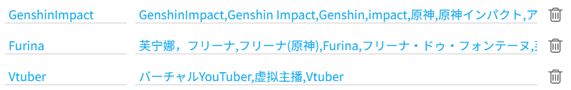
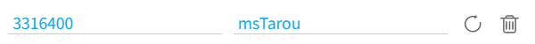

## Tag alias

  <a href="/#/en/Settings-Naming/Aliases?flag=44" target="_blank" class="settingNameStyle" data-bind-click="true">
    Tag alias
  </a>

  

    <label for="useTagAliasForTagsNamingRule" data-xztext="_应用到文件名里的tags系列标记">{tags} series tokens applied to the file name</label>
    <input type="checkbox" name="useTagAliasForTagsNamingRule" id="useTagAliasForTagsNamingRule" class="need_beautify checkbox_switch">
    
  

  <slot data-name="setTagAliasSlot"></slot>

If a tag has multiple variants, you can set a common alias for them, for example:

For example, `GenshinImpact` has multiple variants: `GenshinImpact,Genshin Impact,Genshin,impact,原神,原神インパクト,アリス(原神)`.

If you want to treat all these variants as `GenshinImpact`, you can click the "Add" button to add a rule: set the alias to `GenshinImpact` or another name you want to use, and set the tag list to the variant list.

**Uses:**

- If you have enabled "Use the first matching tag to create a folder", you can use the alias you set here. In this way, all tags belonging to this alias use the alias to create folders, which can be used to unify folder names.

- You can enable the sub-option "Apply to the {tags} series of tags in file names". After enabling it, these tags are affected when you use them in the naming rule: `{page_title}`, `{tags}`, `{tags_translate}`, `{tags_transl_only}`.

For the example above, when the downloader generates file names, it replaces `GenshinImpact,Genshin Impact,Genshin,impact,原神,原神インパクト,アリス(原神)` in the tags of the work with the alias `GenshinImpact` (or another name you set).

## Customize username

  <a href="/#/en/Settings-Naming/Aliases?flag=45" target="_blank" class="settingNameStyle" data-bind-click="true">
    Customize username
  </a>

  <slot data-name="setUserNameSlot"></slot>

You can add a user's ID and set a custom name for them here. This affects the `{user}` naming tag.

For example, the username for https://www.pixiv.net/users/3316400 is `MだSたろう`. If you want to set a custom name, you can enter the user ID as `3316400` and the username as `msTarou`, then save.

When downloading their works, the `{user}` tag will ignore the original name and output the custom name `msTarou`.

After adding a rule, the downloader will display it like this:

If needed, you can modify the settings here (e.g., change the username) and click the refresh button on the right to update the rule. You can also delete the rule.

---

**Use Case 1:** Prevent issues with users changing names.

Some users may frequently change their names. If you want to use their original name, you can set it manually here.

A common case is usernames with an @ symbol, such as:

- Anmi@画集発売中
- 奥馬@skeb募集中
- さしみなす@依頼募集中

While the [Remove @ and subsequent characters in username](/en/Settings-Naming/Remove-special-characters?id=remove-and-subsequent-characters-in-username) feature can address this, some users' names may not use @, for example:

- いの字/inoji
- 焔すばる★２日目 東C17a
- 送り萬都 🔞仕事募集中
- しりー＊C99木曜東A21b
- ショーンC99木東ユ40b
- オムレットマト西ぬ31b

You can set a fixed name for them here.

---

**Use Case 2:** Set aliases or nicknames for users.

For example, if a user's name is in Japanese but you don't input Japanese and it's inconvenient to search on your device, you can set a English alias (or another language you can use) for easier searching.

If a user's name is hard to remember, you can also set an easy-to-remember alias.
