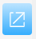
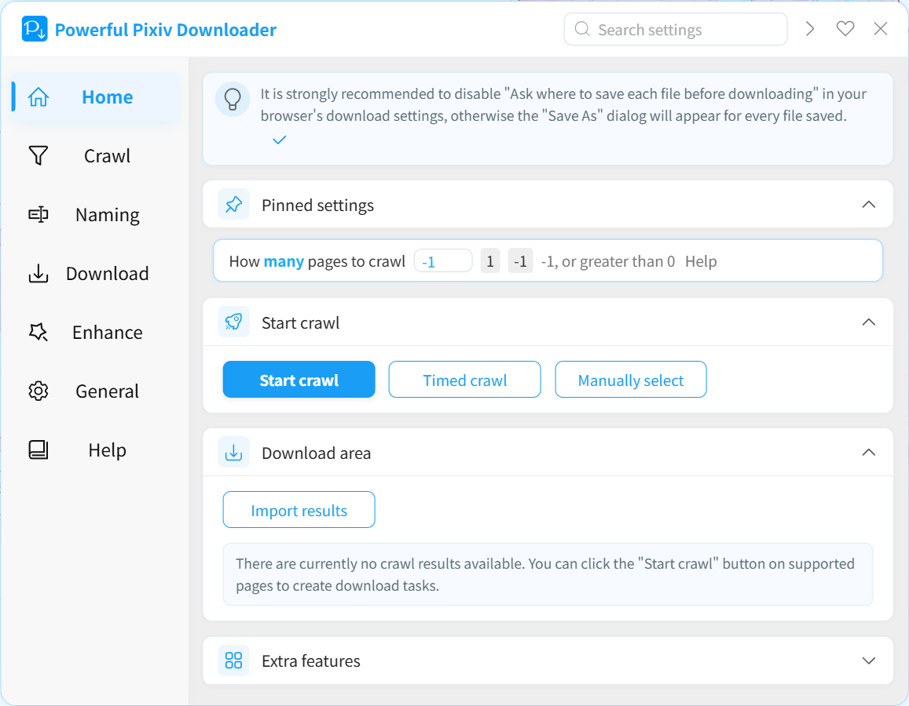
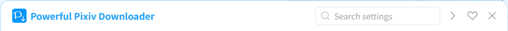
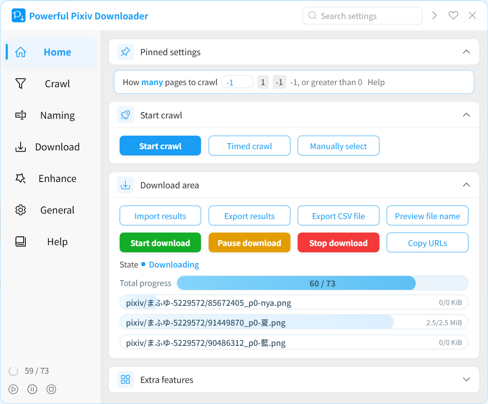
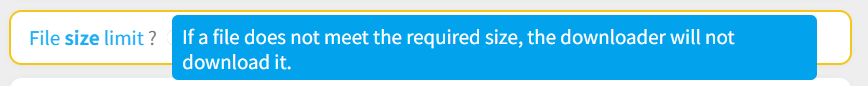
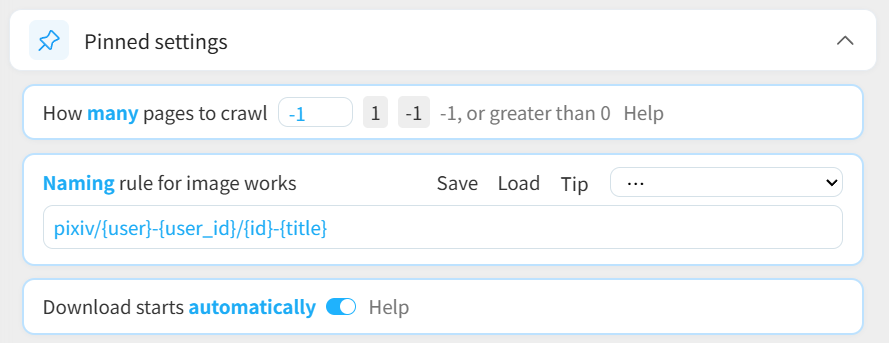

# Getting to Know the Settings Panel

After installing this extension, open a Pixiv web page, and you will see a blue button on the right:

Click this button to open the downloader's settings panel and start crawling and downloading.

## Title Bar

On the right side of the title bar there are 4 areas:
- Search bar, for searching all setting names
- Expand or collapse all settings
- Support me
- Close the settings panel

## Navigation Area

The left side of the settings panel is the navigation area:

Most sections store the settings in that category.

From top to bottom, they are:
- `Home`: the dashboard, which centralizes pinned settings, the Start crawl button, the download area, and extra feature buttons.
- `Crawl`: stores crawl-related settings.
- `Naming`: stores file name-related settings.
- `Download`: stores download-related settings.
- `Enhance`: stores settings for enhanced features.
- `General`: stores language, operation method, appearance, and other settings unrelated to downloading.
- `Help`: stores some help information and external links.

PS: When you search, a temporary `Search` item appears in the navigation area to show the results. It is not shown normally.

## Download Summary Bar

After crawling is complete, the downloader displays a download summary bar below the navigation area:

Previously, the downloader displayed download progress only on the Home page (dashboard), so users could not see it when they were in another navigation category. The download summary bar is always displayed, making it convenient to check download progress at any time.

It has two rows:
- The first row displays the download status and task progress.
- The second row displays three clickable buttons: start downloading, pause downloading, and stop downloading.

## Get Help

Some settings have a question mark after their names. Hovering the mouse over the name will display a simple tooltip, for example:

Some settings also have a **Help** or **Tip** button on the right. Click it to see more detailed instructions.

If you want to view more detailed instructions on the Wiki, click the name of the setting item and the downloader will open the corresponding Wiki page.

PS: For buttons on the Home page, you can also long-press a button to open its Wiki page.

## Pin Settings

The downloader has more than 100 settings. If you use some settings frequently, it is inefficient to search for them every time. The best way to improve efficiency is to pin commonly used settings so they are grouped in the Home page's "Pinned settings" area, for example:

PS: Pinned setting cards have a light blue border.

**How to use:**

Long-press a setting card for 0.5 seconds to pin it. Long-press again to unpin it.

## Opening and Closing the Settings Panel

There are multiple ways to open and close the settings panel.

1. Click the button on the right side of the web page to open the settings panel:

Click the close button in the top-right corner of the settings panel to close it.

2. Click the extension's icon to toggle the settings panel's open/closed state:

!> If the current tab is not a pixiv.net web page, clicking the extension icon has no effect, because this extension only works on pixiv.net.

3. The shortcut key `Alt` + `x` can toggle the settings panel's open/closed state.

4. When the settings panel is displayed, you can click a blank area on the page to close it.
