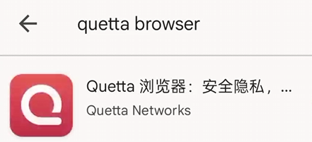
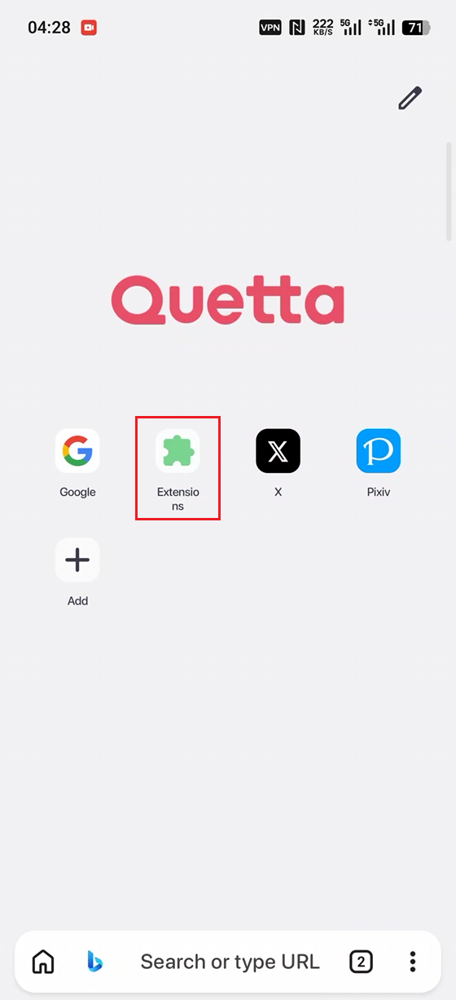
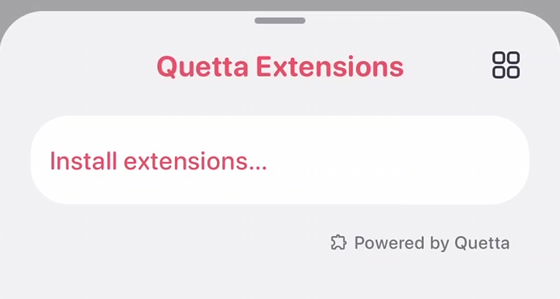
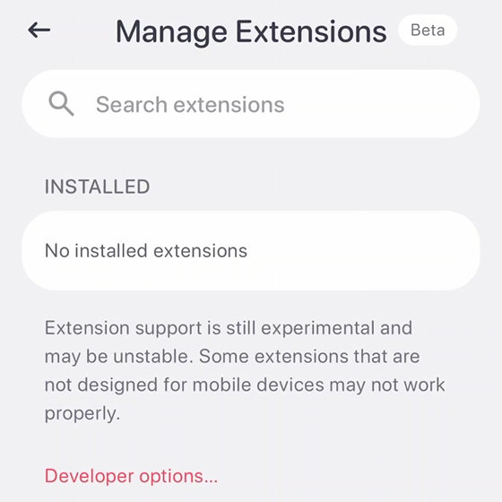
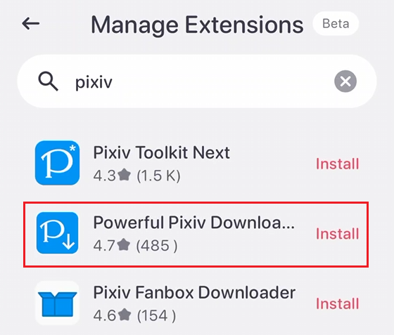
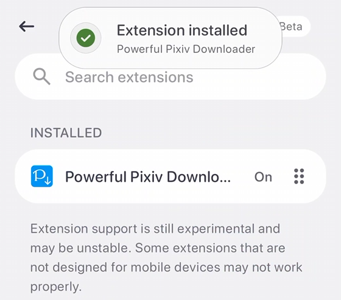
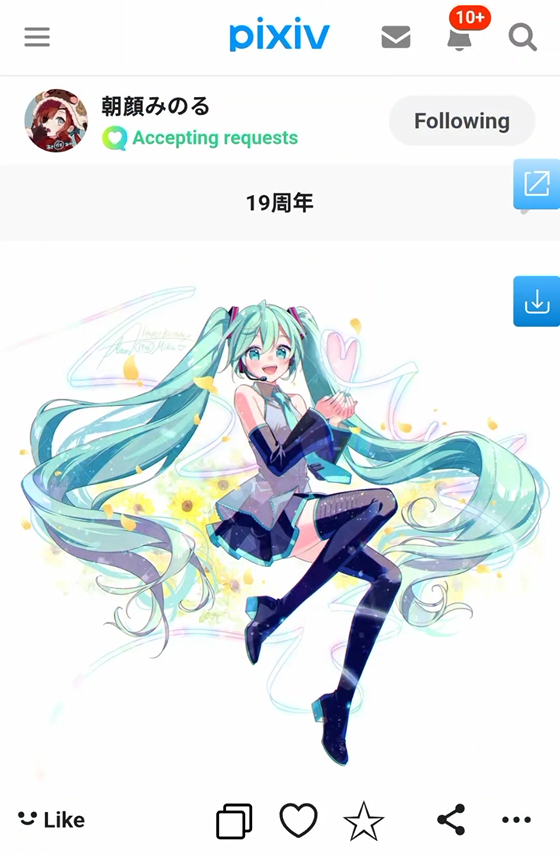
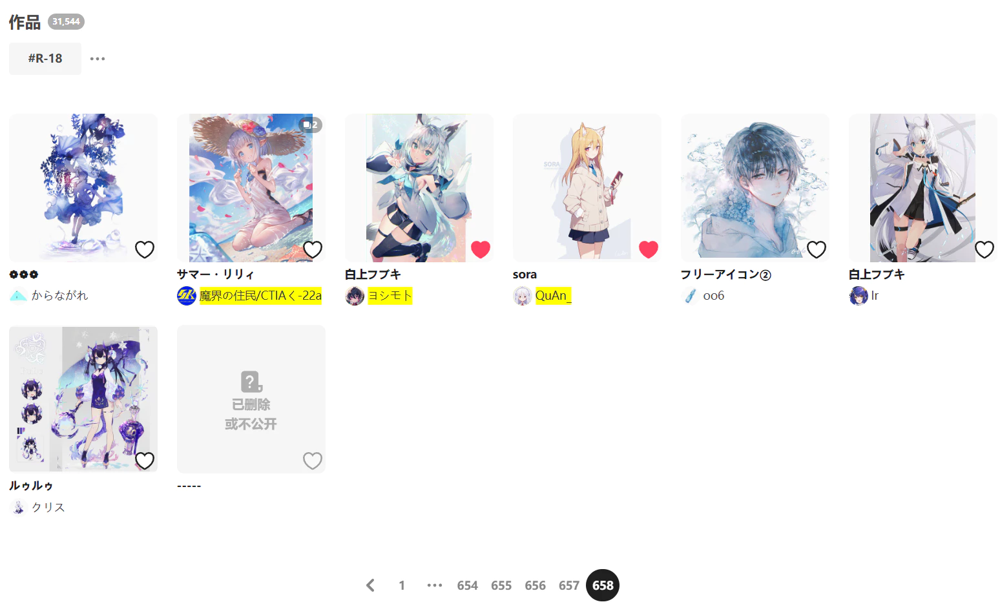
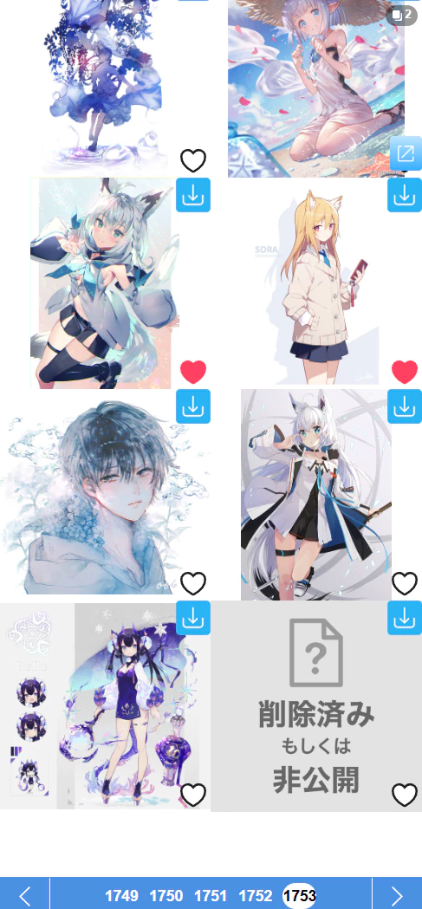

# Install the extension on the Quetta browser on mobile

The Quetta browser is a mobile browser based on the Chromium engine. You can install extensions from the Chrome Web Store online, which is very convenient.

## Installation steps

Install the Quetta browser from Google Play:

After installation, open it. The home page has an "Extensions" feature:

Click it, then select `Install extension...`:

This opens the extension management page, where you can search for extensions:

Enter `pixiv` and search, then click the install button on the right side of `Powerful Pixiv Downloader`:

After the installation is complete, go back to the previous page, and you can see that the extension has been installed:

Then open a Pixiv tab and refresh it once. You should see the downloader's blue button on the right side of the web page:

Now you can use the downloader. Most of its features are the same as on PC, and you can batch download works on various pages.

## Notes

- Downloaded files are saved in the **Download** folder in the device's storage. Browsers on Android do not seem to support changing the download directory, so files can only be saved there.
- On PC, the downloader can have the browser create subfolders to save files, but not on Android. The browser does not create subfolders (this may be a system limitation), so files are saved directly in the download folder. This is not a bug of the downloader.
- Since the browser does not create folders, only the last segment of the downloader's naming rules takes effect. For example, the default naming rule is `pixiv/{user}-{user_id}/{id}-{title}`, but in practice only `{id}-{title}` takes effect. If you modify the naming rules, you need to make sure the last segment contains `{id}`, which is the unique identifier of each file on pixiv and can avoid works with different IDs producing the same file name.
- On PC, when the downloader saves the same file again, it overwrites the old file. However, mobile browsers save files with the same name and add a sequence number, for example:

- On the mobile web page, some enhancement features of the downloader are unavailable or affected, such as previewing works.
- If your device is in landscape orientation (e.g., a tablet), you can try enabling desktop mode in the browser's menu to improve the downloader experience. This is because the downloader interface has a lot of content, which is inefficient and not a good experience in portrait mode.

## Page count differences

On some work list pages, the PC version of the web page shows more works per page, while the mobile version shows fewer.

For example, on the bookmark page, the PC version shows 48 works per page, but the mobile version shows 18.

If you start crawling all works from the first page, there is no impact. But if you need to set the crawl page numbers, or start crawling from a page in the middle, you need to be aware of this difference, because the downloader currently crawls according to the PC rules, assuming the bookmark page has 48 works per page.

Here is an example. A user currently has 31,544 bookmarks, which is 658 pages on PC, but 1753 pages on mobile:

**Possible impacts:**

- If you set the crawl page count to 1 on the mobile page, the downloader will crawl 48 works instead of the 18 you see.
- If you start crawling from page 1000 on mobile, the downloader will not be able to crawl any works, because there is no page 1000 on PC.

PS: You can use the PC page (desktop mode) to avoid this difference.

## Keep the browser visible when converting Ugoira

Due to the characteristics of the Android system, when the browser is switched to the background or the device screen is off, its power consumption is limited.

Usually this does not have much impact on the downloader. The downloader can still crawl and download files normally. However, if the downloaded files contain Ugoira, it may be seriously affected.

The downloader can convert Ugoira on pixiv to other formats (such as WebM, GIF, APNG), but the CPU usage during conversion is relatively high. If the browser is in the background or the device screen is off, the worst case is that the Ugoira conversion stops completely. This may cause the download progress to stall and be unable to continue downloading.

When necessary, you should keep the browser in the foreground, or switch its view to picture-in-picture mode (keeping it visible), to avoid this problem.
