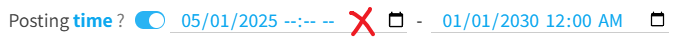

You can download only the works that were posted within a certain time range.

**Usage examples:**

- If you want to download works posted after a certain time, set "Start time" to that time, and set "End time" to a time in the future.
- If you want to download works posted before a certain time, set "Start time" to a time in the past, and set "End time" to that time.
- If you want to download works posted within a specific period (such as one year or one month), set both the start time and the end time.

**How to enter the time:**

You can click the icon on the right side of the input box to use the time and date picker provided by the browser, or click the input box and enter the numbers manually, or use the "Past", "Now" and "Future" buttons to set the time quickly.

**Note:** When you enter it manually, the complete time and date must be included. As shown in the image below, the value on the left is wrong because it does not include the time:

?> The first illustration on pixiv is https://www.pixiv.net/artworks/20 , and its posting time is `2007-09-09T13:14:07+00:00`
