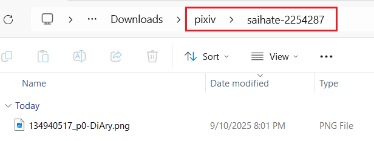

This is a very important feature, allowing you to set the **filename** saved by the downloader and **create folders** for organization.

When saving files, the downloader replaces tags in the naming rule to generate filenames. For example, `{id}` is replaced with the work ID, such as `75863159_p0`.

?> You can modify the naming rule as needed. Only `{id}` is mandatory, as it is the unique identifier for each file.

**Some function buttons:**

The `Save` button saves the current naming rule, and the `Load` button displays previously saved naming rules. With these two buttons, you can save multiple commonly used naming rules and switch between them conveniently.

The `Tip` button lets you view all tags and their descriptions. However, this is a Wiki, so it has no effect here.

The dropdown list displays all tags. Clicking one inserts it at the cursor position. However, this is a Wiki, so it has no effect here.

### Creating Folders

You can use a slash `/` to create folders. If needed, you can use multiple slashes `/` to create nested folders.

The default naming rule `pixiv/{user}-{user_id}/{id}-{title}` creates two levels of folders:
- First, a `pixiv` folder is created.
- Inside it, a folder with the username and user ID is created.
- Inside that, the work is saved with a filename consisting of the work ID and title.

Example effect:



?> The `/` is not mandatory. If you don't want to create folders, you can omit the `/`. For example, setting the naming rule to `{id}` saves files directly to the browser's download directory without creating subfolders.

### Additional Notes

- You can use multiple tags; it's recommended to add separators between tags, such as `{id}-{tags}-{user}`, to avoid tag content blending together. There's no fixed requirement for separators; use what you prefer.
- Besides preset tags, you can input custom text, e.g., `Title {title} Tags {tags}`. Non-preset text will be retained as is.
- There's no suffix tag because the downloader automatically adds the file extension.
- If the generated filename contains special characters invalid for filenames, they are replaced with similar full-width symbols. For example, a tag containing a slash `/` cannot be used in filenames, so the downloader replaces it with a full-width `／`.
- If you use `{tags_translate}`, there's no need to use `{tags}`, as the former includes the latter. Translated content depends on your Pixiv language settings. For example, if your Pixiv interface is in Chinese, tag translations are typically in Chinese.
- `{tags_transl_only}` saves only translated tags, not original Japanese tags. If a tag has no translation, the original Japanese tag is saved.
- Filenames must include a **unique identifier** to prevent duplicates, which could cause files to overwrite each other or trigger a save-as dialog.
- The default naming rule's `{id}` is the unique identifier. Some users may want to replace `{id}` with `{pid}` and `{p}`. This is possible, but both must be used together, not individually. This is because multi-image works have multiple images with the same `{pid}`, and `{p}` is needed to differentiate them.
- `{bmk_1000}` doesn't show the exact bookmark count but displays an integer in units of 1000 with a `+` (below 1000 displays as `0+`). This makes bookmark counts less cluttered.
- When saving files, if a file with the same name exists, the downloader will overwrite it rather than appending a number. Most PC browsers do this, but Edge Canary on Android may append a number instead.
- Filenames may exceed the operating system's length limit, often due to tags like `{tags}`. If a filename is too long, the file may not save automatically, and the browser may show a save-as dialog. To address this, enable the "Filename Length Limit" option under the "More" tab in the "Naming" category.
- When a filename is too long, some browsers may truncate the excess to save the file. This varies by case. Chrome on Windows does this, but browsers on Linux or Android may not. Saving to remote locations (e.g., network drives) may also prevent truncation, even in Chrome.

The available values for `{page_type}` (page type name) are as follows:

```
Unsupported, Home, Artwork, UserHome, BookmarkLegacy, Bookmark, ArtworkSearch, AreaRanking, ArtworkRanking, Pixivision, BookmarkDetail, NewArtworkFromFollowing, Discover, NewArtworkFromAllUsers, Novel, NovelSeries, NovelSearch, NovelRanking, NewNovelFromFollowing, NewNovelFromAllUsers, ArtworkSeries, Following, Request, Unlisted, DiscoverUsers, Dashboard, Contest, SearchUsers
```

### Some Examples

#### Remove the p tag in {id}

`{id}` includes the page number, for example `44920385_p0`. If you want to remove `_p`, you can replace `{id}` with `{pid} {p}`, which will generate `44920385 0`.

?>Note: If you want to replace `{id}`, the naming rule must include both `{pid}` and `{p}` to prevent duplicate filenames.

#### Remove the sequence number from the first image of each work

If you think the first image doesn't need a sequence number and want to change `44920385_p0` to `44920385`, you can enable the [setting:47] option.

#### Naming rules used by others

Here are some naming rules used by users, you can refer to:

```
{user}/{title}{id}
{user}/{title}{date}/{id}
{user_id}_{user}/{type}/{date} {title}/{id}
{user_id}-{user}/{title}-{id}
{user} (id={user_id})/{id}
{user} {user_id}/{id} {title} {upload_date}
{user}_{date}_{title}_{id}
{id}_{title}_{user_id}_{user}
{id}{user}-{user_id}-{title}{tags}{tags_translate}{page_tag}-{like}-{bmk}-{upload_date}
```

**Note:** The last naming rule is not a good idea because it easily generates filenames that are too long (more than 256 characters), leading to truncation, so the actual filename may only have the first half.

Some works have a large number of tags, so using `{tags}`, `{tags_translate}`, `{tags_transl_only}` in the filename may lead to the filename being too long. If you want to use these naming tags, it is recommended to place them at the end of the filename to avoid truncation of content from other naming tags.

### Sorting with Naming Tags

Some tags have predictable patterns. Using them as the **first part** of the filename allows sorting in the file explorer.

#### Tags Reflecting Time Order

On most pages, works are sorted by work ID in descending order. Later-posted works have larger IDs and appear first.

`{id}` (work ID) is incremental. Using `{id}` at the start of the filename and sorting files by ID in descending order aligns with the webpage's order. For example:


`{date}` (posting time) has a similar effect.

--------

`{bmk_id}` reflects the order in which you bookmarked works. Using it at the start, e.g., `{bmk_id}-{id}`, and sorting in descending order aligns files with your bookmark order.

For example, this is the webpage order:


This is the effect of sorting with `{bmk_id}`:


#### Tags Reflecting Quantity

Some tags are numeric, e.g., `{like}`, `{view}`, `{bmk}`, `{bmk_1000}`, `{rank}`.

Example: Sorting works by `{bmk}` (bookmark count) in descending order prioritizes high-quality works:


Example: When downloading from a leaderboard page, sort by `{rank}`:


