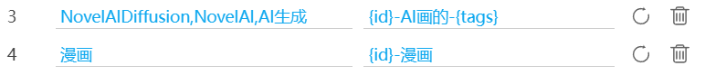

This is a hidden setting.

You can add custom rules, for example:

If a work contains the specified tags, the downloader uses the folder part from the default naming rule combined with the filename part specified here to create a new naming rule.

Since this setting was designed for a specific user, it has special rules:

1. The "naming rule" here should only include the **filename** rule. It should not include folders (i.e., no slashes `/`), as this may cause unexpected results.
2. The "naming rule" must start with `{id}`. Regardless of whether you include `{id}`, the downloader internally adds `{id}` to the beginning.
