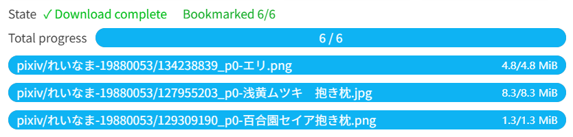

When enabled, the downloader will bookmark the work associated with each downloaded file.

Bookmark progress is displayed in the download progress area, e.g., `Bookmarked 1/3`.

After downloading, if the bookmark progress shows matching numbers, e.g., `Bookmarked 3/3`, bookmarking is complete. If the numbers differ, wait for bookmarking to finish.

**Notes:**

1. If a work is skipped due to the "Don't download duplicate files" setting, it is still considered successfully downloaded and will be bookmarked.
2. A work may have multiple files but is bookmarked only once. If the bookmark count is less than the file count, this is normal, as the bookmark count reflects the number of works, not files.
3. When downloading large amounts of files, the bookmark progress may increase relatively slowly. This is because the downloader will bookmark one work every few seconds (using the interval time in [setting:28]), rather than quickly and continuously bookmarking works. This is to reduce the possibility of triggering the 429 restriction.

If you want to set the public status when bookmarking a work, as well as whether to add tags, please check this setting: [Downloader's bookmark feature (✩)](/en/Settings-More-Enhance?flag=34).
