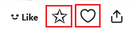

When this feature is enabled, the downloader will automatically download the work when you click its bookmark button.

There are two main use cases:

1. Clicking the bookmark button in the bottom-right corner of the work:

 

2. Clicking the bookmark button inside the work page:

?> Although the screenshots above are for illustrations, this feature also works for novels.

?> This feature is only triggered by **clicking the bookmark button**. The downloader provides some batch bookmarking and quick bookmarking features, but they do not require clicking the bookmark button and thus will not trigger this feature. For example, pressing B while previewing a work will bookmark it but will not trigger this feature.

!> In page types not supported by the downloader, this feature will not work, even if you manually click the bookmark button. This is because the feature requires the downloader to locate the work thumbnail element, but the downloader does not perform this action on some less common pages.

The downloader provides this feature by default:

When you are on a page, hovering the mouse over an illustration thumbnail should show a button in the top-right corner.

This indicates that the downloader supports the page and can use the "Download Work When Clicking the Bookmark Button" feature. However, if the downloader does not display the top-right button, the page is not supported, and the "Download Work When Clicking the Bookmark Button" feature cannot be used.
