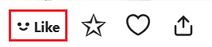

When this feature is enabled, the downloader will automatically download the work when you like it on the work page.

Like button:

?> Although the screenshot above is for an illustration, this feature also works for novels.
