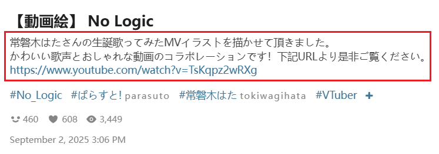
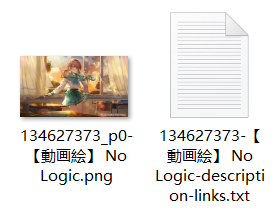

If you enable this feature, the downloader will create a TXT file for each work to save its description.
The description refers to the text below the work's title. For example:



The TXT description file saved by the downloader:



The filename of the TXT description file may include two markers:

1. A `description` marker, which is always included. This marker depends on the downloader's language setting, e.g., it is `简介` when using Chinese.
2. If the description contains URL links, the downloader will add a `links` marker.

?> Some works do not have a description, in which case the downloader will not create a TXT description file for them.

?> Work type: you can choose which types of works to save descriptions for. "Novel" is not selected by default, because the downloader saves the description at the beginning of a novel by default, so there is no need to save it again here.

This setting has two sub-options, which can be enabled simultaneously:

### Save each work separately

Create a TXT description file for each work. When downloading multiple works, the downloader will generate multiple description files.

### Summarize to one file

When crawling is complete, the downloader will generate a TXT file aggregating all work descriptions.

The **save location** for this file has two cases:

1. If the aggregated file's description data comes from works by multiple different users, it will be saved directly to the browser's download directory. Since it does not belong to a specific user, it should not be placed in a username folder.

2. If the description data comes from the same user:

- If a folder in the naming rule contains `{user}`, the downloader will save the aggregated file in that folder. For the default naming rule, it will be saved in `pixiv/{user}-{user_id}/`.
- If none of the folders in the naming rule contain `{user}`, the downloader will save it directly to the browser's download directory.

The **filename** of the aggregated file includes multiple parts:
1. `description summary` marker, which changes based on the downloader's language.
2. `user` marker with the username. This is only present if all data in the aggregated file comes from the same user.
3. Current page title
4. Time and date

For example:

```
description summary-user saihate-No_Logic, virtual YouTuber ／ 【動画絵】 No Logic ／ September 2nd, 2025 - pixiv-9／10／2025, 11：31：11 PM.txt
```
