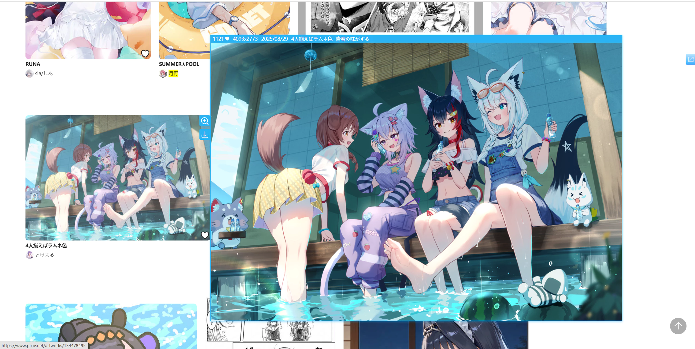
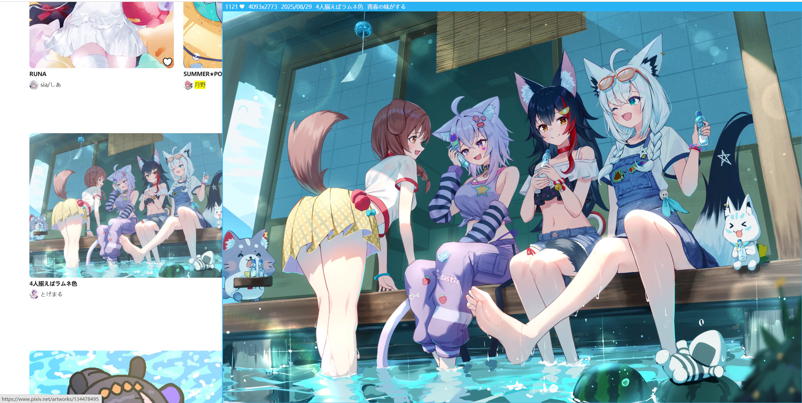
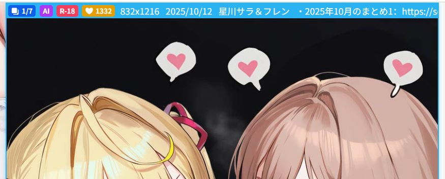

This feature is enabled by default. When the mouse cursor hovers over a work thumbnail, the downloader displays a larger preview image, as shown below:

<!-- https://www.pixiv.net/artworks/134677173 -->

?> The preview image adapts to the available area and won't exceed the screen.

To **close the preview image**, use one of these methods:
- Move the mouse cursor outside the thumbnail area
- Click the preview image
- Press the `Esc` key

### Shortcut Key List

Use the shortcut key `Alt` + `P` to toggle the preview work feature on or off.

When you view the preview, you can use these hotkeys:
- `V`(iew) View the original image at 1:1 native ratio
- `B`(ookmark) Bookmark the previewed work
- `C`(urrent) Download the currently previewed image (if the work has multiple images, only the current one is downloaded)
- `D`(ownload) Download the currently previewed work (if the work has multiple images, all of them are downloaded by default)
- `Alt` + `C`(opy) Copy the currently previewed image and work info (you can modify this hotkey)
- `Esc` Close the preview. Also, clicking the left mouse button on the preview can also close it
- `← ↑` Previous image
- `→ ↓` Next image
- `Space` Next image

------

**Sub-option:**

### View image dimensions

You can choose which image size the downloader loads when previewing works.

- `Original`: Loads the original image. Some original images may be large, so loading may be slower.
- `Regular`: Default, loads regular-sized images. These are smaller, so they load quickly.

?> This option only affects the image size during preview, not the size during download.

**Difference between sizes:**

- If the original image's dimensions exceed 1200 px, the regular size will be 1200 px.
- If the original image is smaller than 1200 px, the regular size matches it. For example, if the original is 500 x 500 px, the regular size is also 500 x 500 px.

**Display area differences:**

When selecting "Original," if the image is larger than 1200 px and there's enough space around it, the downloader displays a larger preview image.

Here's an example. The regular image width is 1200 px:

The original image width is 4093 px, so the display area is larger:

?> Although the original image can sometimes be displayed larger, this isn't always the case. If the available area around the thumbnail is limited, the regular image may already fill it, and the original won't appear larger.

### Allow the preview image to cover the thumbnail

When previewing a horizontal image, the preview is often quite wide. If the view image dimensions setting is `Regular`, the preview is usually 1200px wide; if it is `Original`, the preview may take up the full page width.

However, the space on the left or right side of the thumbnail may not be enough to fully display the preview, in which case:
- If this switch is enabled, the preview maintains its original size as much as possible (without shrinking), but it may cover the thumbnail. Tip: you can click the thumbnail to make it disappear.
- If this switch is disabled, the preview is usually displayed smaller to avoid covering the thumbnail.

### Check blocked tags

This feature is disabled by default.

If you enable it, the downloader checks whether the work contains either of these two kinds of blocked tags:
1. The `must not contain tags` you configured in the downloader
2. The tags you muted in your Pixiv account settings

If the work matches either blocked condition, the downloader will not preview it.

### Use the mouse wheel to switch images in multi-image works

This feature is enabled by default.

When previewing a work with **multiple images**, you can scroll the mouse wheel to switch between images.

- Scrolling down shows the next image
- Scrolling up shows the previous image

?> If the mouse wheel is used to switch images, the downloader prevents page scrolling. This is because page scrolling would move the mouse away from the thumbnail, causing the preview area to disappear.

### Use the arrow keys and space bar to switch images

This feature is enabled by default.

It enables the following shortcuts:
- `←` `↑`: Previous image
- `→` `↓`: Next image
- `Space`: Next image

When the preview area is displayed and this feature is enabled, the downloader prevents the default behavior of these keys, so they won't scroll the page.

If you want these keys to always scroll the page, disable this feature.

### Wait Time

After the mouse enters the thumbnail area, if it doesn't leave within a certain time, the downloader prepares to display the preview image.

The default wait time is `400` milliseconds, which you can adjust as needed.

### Show summary

This feature is enabled by default.

The downloader displays some information at the top of the preview image. For example:

The information displayed from left to right is as follows:

- Current image number and total number of images being viewed, such as `1/7`. This information is only displayed when the work contains multiple images.
- `AI` tag. This tag is only displayed when the work is generated by AI.
- `R-18` or `R-18G` tag. All-ages works will not display this tag.
- Number of bookmarks for the work.
- Image dimensions (always displays the dimensions of the first image)
- Posting time of the work
- Title of the work
- Description of the work (if any)
