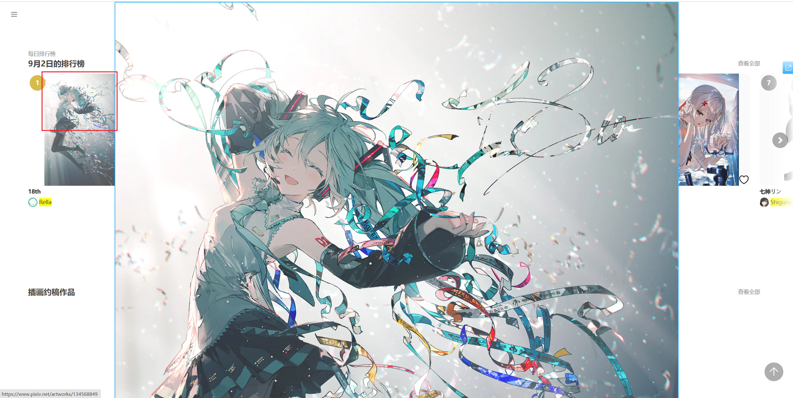

When previewing a work, long-pressing the right mouse button on a thumbnail displays the full image.

By default, the downloader loads the original image and displays it at its original size (1:1). If the original image is large, it may exceed the screen (this is not a bug).

For example, when viewing the original image of this work, only the top half is shown:

**Tips:**

- If parts of the image exceed the screen, move the mouse cursor to view the full image.
- Use the mouse wheel to zoom in or out.
- When previewing a multi-image work, the full image shown matches the previewed image (e.g., `3/10`).

To **close the full image**, use one of these methods:
- Click the left mouse button.
- Press the `Esc` key.
- Press the `V` key.

### Shortcut Key List

When you view the full image of a work, you can use these shortcuts:
- Mouse wheel: Zoom the image in or out
- `B`(ookmark) Bookmark the work you are viewing
- `C`(urrent) Download the currently viewed image (if the work has multiple images, only the current one is downloaded)
- `D`(ownload) Download the currently viewed work (if the work has multiple images, all of them are downloaded by default)
- `Alt` + `C`(opy) Copy the currently viewed image and work info (you can modify this shortcut)
- `V` and `Esc` Close the preview. Also, clicking the left mouse button on the preview can also close it

### View image dimensions

You can choose whether the downloader loads the original or regular image when displaying the full image. The default is original.

Regular images have a maximum size of 1200 px, while original images may be larger, so they may appear bigger at 1:1 display.
