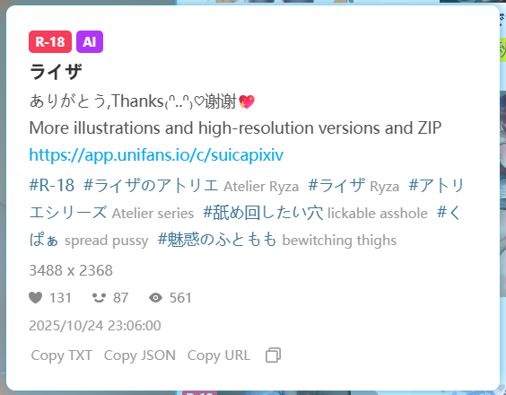

Normally, you can only view detailed information, such as a work's description, tag list, view count, like count, and bookmark count, on the work's page.

If you want to view details without entering the work's page, enable this feature. When you hover over a thumbnail, the downloader will display detailed information, such as:

Links in this panel, such as URLs in the description or tag links, are clickable.

To close the details panel, click it or move the mouse outside its boundaries.

**Bottom Buttons:**

There are some buttons at the bottom of the panel:

- `Copy TXT` Click it, and the downloader will copy some metadata to the clipboard, the content is the same as the TXT file generated by the [setting:73] function.
- `Copy JSON` Click it, and the downloader will copy the work's JSON data (unprocessed raw data).
- `Copy URL` Click it, and the downloader will copy the work's URL.
- `Copy Button` Click it, and the downloader will copy the first image of the work and the text summary.
