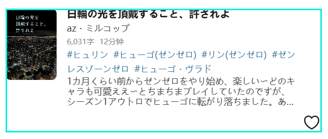

This feature depends on the download records saved by the downloader itself.

If you want to see at a glance whether a work has already been downloaded, you can enable this setting.

The downloader will display a border on downloaded works. The default border is red, as shown below:

The left one has not been downloaded, and the right one has.

This setting has 2 sub-options: you can set the border width and color. Below is the effect with a border width of `4` px and a color of `#91e2df`:

Known issue:

To prevent the border from being covered or clipped by other elements, the downloader displays it inside the thumbnail area. Because of that, it covers the edge area. This usually does not matter for image works, but on some pages for novel works it may cover the text at the top:

