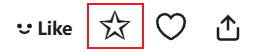

You can use this setting to control the downloader's behavior when bookmarking works.

**Sub-options:**

When using features affected by this setting, you can configure:

- Whether to bookmark publicly: add it as a public or private bookmark
- Whether to add tags

The default is a public bookmark with the work's original tags.

?> If a work has already been bookmarked, you can still bookmark it again. This will not change its bookmark time (and thus will not affect its order on the bookmark page), but it can update its public status and tag list. For example: if a work was previously set to public and had tags added, you can, if needed, change the settings to private with no tags and have the downloader bookmark it again.

**Features affected by this setting:**

1. Quick bookmark button (☆) on work pages:

2. Quick bookmark button (☆) when previewing search results on search pages:

3. Bookmarking a work with the `B` shortcut while previewing.
4. Bookmarking a work by clicking the (☆) button in the image viewer.
5. [setting:53] feature.
6. "Bookmark all works on this page" feature in the downloader's "More" tab on user homepages and search pages.

**Features not affected by this setting:**

1. Pixiv's original bookmark button (heart-shaped) is not affected by this setting.

2. The "Add tags to uncategorized works" button on the bookmark page is not affected by some of these settings. This feature always adds tags (but per this setting, it uses the work's original tags or the translated tags); the public status follows the work's prior bookmark status, i.e., it does not change the public status.
