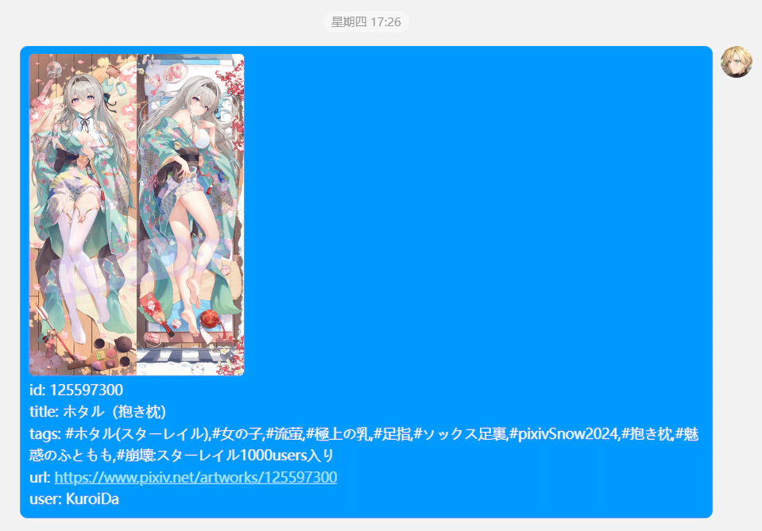
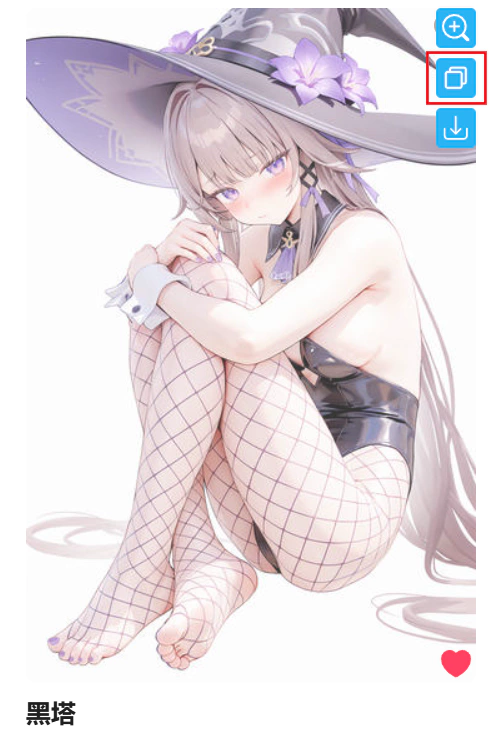
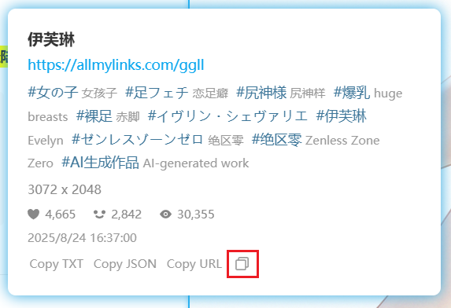
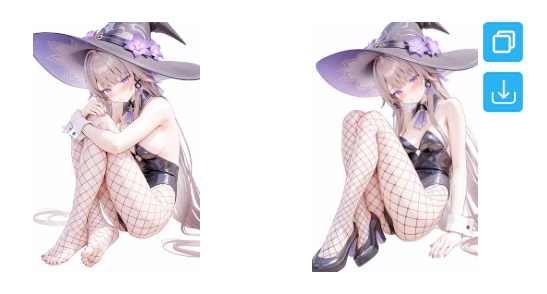
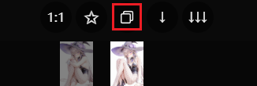
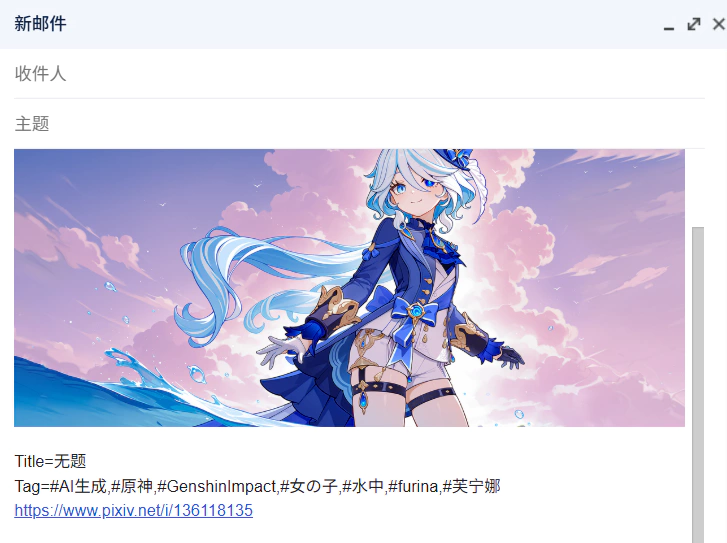
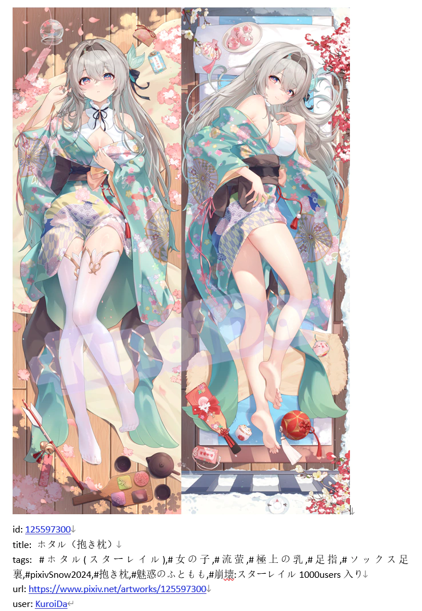
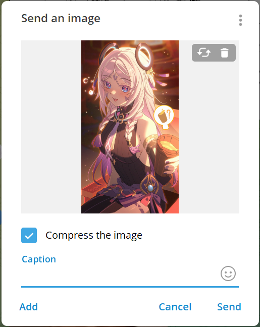
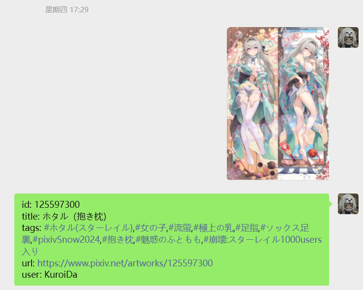
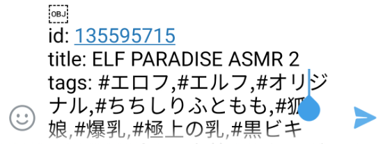

The downloader will display a copy button on the work thumbnail and within the work page. Clicking it allows you to copy the work's image and some data. You can paste it into other software to save or share with others. For example:

### Usable Scenarios

Overall, there are two methods:
- In some scenarios, the downloader displays a copy button; clicking it performs the copy.
- In some scenarios, there is no copy button; use the shortcut `Alt` + `C`.

Detailed explanations follow:

#### Copy Button on Thumbnails

Click the copy button to copy.

At this point, the downloader will only copy the first image of the work.

#### Copy Button Below the Image in the Work Page

Click the copy button to copy.

At this point, the downloader will only copy the first image of the work.

?> In the work page, you can press the shortcut `Alt` + `C` to use the copy function.

#### When Previewing Work Details

Click the copy button to copy.

At this point, the downloader will only copy the first image of the work.

-----------

In the following usage scenarios, the downloader will copy the currently viewed image, rather than always the first one.

#### Copy Button on Thumbnail List in the Work Page

The downloader adds a thumbnail list on multi-image work pages. Click the copy button to copy.

The downloader will copy the image corresponding to this thumbnail, not fixed to the first one.

#### When Previewing a Work

Press the shortcut `Alt` + `C` to copy the currently viewed image.

#### When Long-Pressing the Right Mouse Button on a Work Thumbnail to View the Large Image

Press the shortcut `Alt` + `C` to copy the currently viewed image.

#### In the Image Viewer

Click the copy button, or use the shortcut `Alt` + `C` to copy the currently viewed image.

### Copy Content

You can choose the content to copy based on your needs.

**Description of Each Format:**
- `image/png` copies the work's image. Not selected by default, because its priority is too high in some social software, causing `text/html` content to be ignored.
You can choose to copy the original image or the thumbnail.
- `text/plain` copies the work's text information. Almost all applications support pasting plain text content.
- `text/html` copies both the work's image and text information simultaneously. This is rich text format, containing both of the above. In the HTML-formatted text, the downloader adds hyperlinks to the work ID, URL, and author name, but many software remove the hyperlinks during pasting, retaining only the text, so there may be no hyperlinks after pasting.

**Tips:**
- The focus of this feature in design is to copy both image and text content (`text/html`) simultaneously for sharing or archiving, but the actual effect depends on the target application. Some applications may not support this format or cannot display the image correctly.
- You can select multiple formats at the same time, meaning copying multiple contents. However, when pasting in an application, the application will only use one of them—the format with the highest priority. Other formats will be ignored.
- Priorities may differ across applications. This is unrelated to the downloader.
- For example: if you copy both `image/png` and `text/html` content, some applications will use the former, while others may use the latter. If the pasted content does not meet your expectations, you can deselect one of the formats.

### Image Size

You can choose the size of the image to copy:
- `Original`: Default value, the downloader will copy the original image.
- `Regular`: The downloader will copy the thumbnail (maximum size 1200px).

**Behavior When Copying Images:**

- The downloader copies the original image by default. However, some original images are quite large (for example, over 30 MiB), and may not paste properly in certain applications. If you encounter this issue, you can change the "Image Size" setting to `Regular`.
- For illustration and manga works, the downloader copies the first image or the one you're viewing, depending on the scenario.
- For Ugoira works, the downloader always copies its static thumbnail.
- For novel works, the downloader always copies its cover image.

### Text Format

You can set the format for the downloader to copy text content, which affects the generated `text/plain` and `text/html` content.

You can use all tags from the naming rule, or input custom characters, such as spaces, underscores, or tag names.

Additionally, you can use these tags:

- `{url}` the URL of this work
- `{n}` line break

-----------

The default text format rule is `id: {id}{n}title: {title}{n}tags: {tags}{n}url: {url}{n}user: {user}`, and the generated text content example is as follows:

id: [134304155](https://www.pixiv.net/i/134304155)

title: 黑塔

tags: #女の子,#崩壊スターレイル,#尻神様,#おっぱい,#裸足,#ヘルタ,#黑塔,#網タイツ,#AI生成作品,#崩坏星穹铁道

url: [https://www.pixiv.net/i/134304155](https://www.pixiv.net/i/134304155)

user: [光怪陆离](https://www.pixiv.net/users/95485582)

### Some Screenshots

I tested the pasting effects. Many PC software perform well, but Android applications do not, so I only recommend using this feature on PC.

#### Browser

Input areas on web pages can only paste plain text content by default, i.e., `text/plain`.

Some web applications may have targeted optimizations, for example, in Discord you can paste images `image/png`.

In Gmail, you can paste both image and text simultaneously, i.e., `text/html`, for example:

#### Microsoft Word

Word prioritizes `text/html` format content, then `image/png`, and finally `text/plain`. For example:

#### Telegram

Telegram does not support `text/html` format, so you cannot paste both image and text simultaneously in Telegram.

Other format priorities are: `image/png`, `text/plain`.

If you want to paste an image in Telegram, select the `image/png` format to paste the image:

#### QQ

QQ's priority is: `image/png`, `text/html`, `text/plain`.

If you want to paste both image and text in QQ, select `text/html` and deselect `image/png`; otherwise, only the image will be pasted.

#### WeChat

WeChat has the same priority as QQ. You can paste both image and text simultaneously, but WeChat splits them during sending. For example:

#### Android Applications

Some Android applications can paste `text/html` content, but the image may not display:

If you want to send an image, select the `image/png` format and deselect other formats. This way, the downloader only copies the image, which can be pasted in some applications.

Some Android applications can paste images copied by the downloader, such as Telegram and WeChat. But in some applications, images cannot be pasted, such as QQ.
