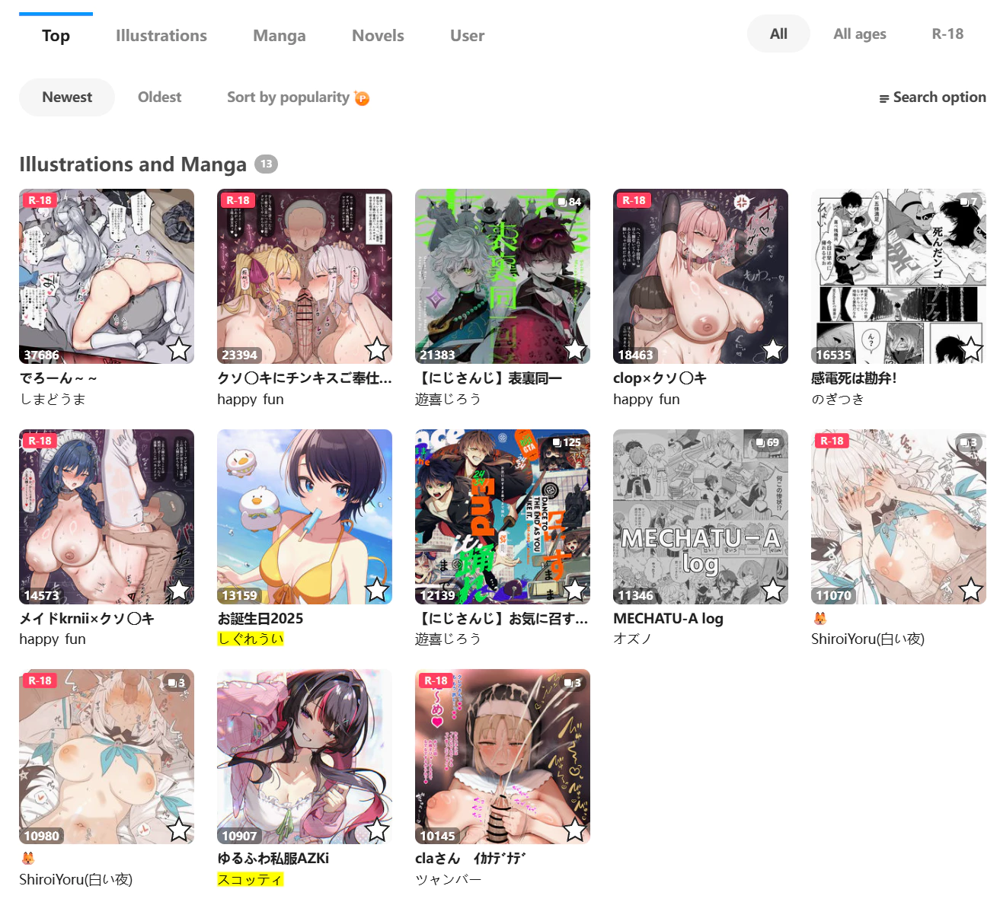

When you crawl illustrations and manga on search pages (/tags and /search), the downloader can display the crawled works on the page, sorted by bookmark count from high to low.

Example:

This feature provides a WYSIWYG experience. You can preview the crawl results, filter them, and then download them.

**Adjusting the crawl results:**

On these pages, after crawling is completed, you can use these buttons in the settings panel to adjust the crawl results:

- After changing the filter conditions, click "Filter in results"
- Clear multi-image works, clear Ugoira works, manually delete works, manually exclude works

**Number of works displayed per page**:

When there are many crawl results, the downloader displays them in pages to reduce performance pressure.

You can set the number of works displayed per page. The default is 100. Changes take effect immediately.

---

**Note:** When this feature is enabled, the "Automatically start downloading" setting does not take effect. This is to give you a chance to filter the results before downloading, and then download them. If you want to automatically start downloading after crawling, you can disable this feature.

?> This feature does not take effect on novel search pages.
