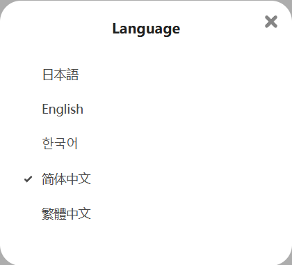

You can choose the language used by the downloader.

The default is `Auto`, where the downloader uses the same language as the Pixiv page. You can also manually select a language.

?> You can use a different language from the Pixiv page. This setting only affects the downloader, not Pixiv's pages.

--------

Tip: Pixiv offers multiple language options. Click your avatar and select Language settings to switch languages:

?> Pixiv previously offered a Russian language option, but it's no longer available. If you're a Russian user, you can manually select `Русский` in the downloader's Language settings to use Russian.
