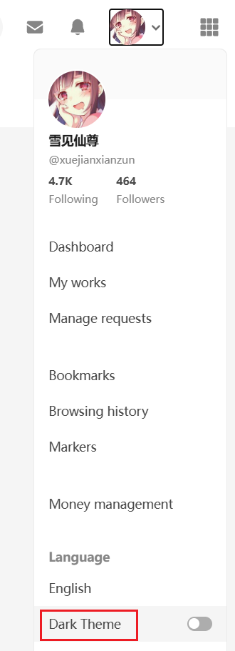

You can choose the downloader's color theme.

- `Auto detect`: the default. The downloader will automatically detect the page background color and Pixiv's color theme to decide whether to use light mode or dark mode.
- `White`: Light mode
- `Dark`: Dark mode

?> The downloader defaults to following Pixiv's color theme.

Pixiv's pages default to light mode. To use dark mode, click your Pixiv avatar and select "Dark mode" from the menu, as shown:

