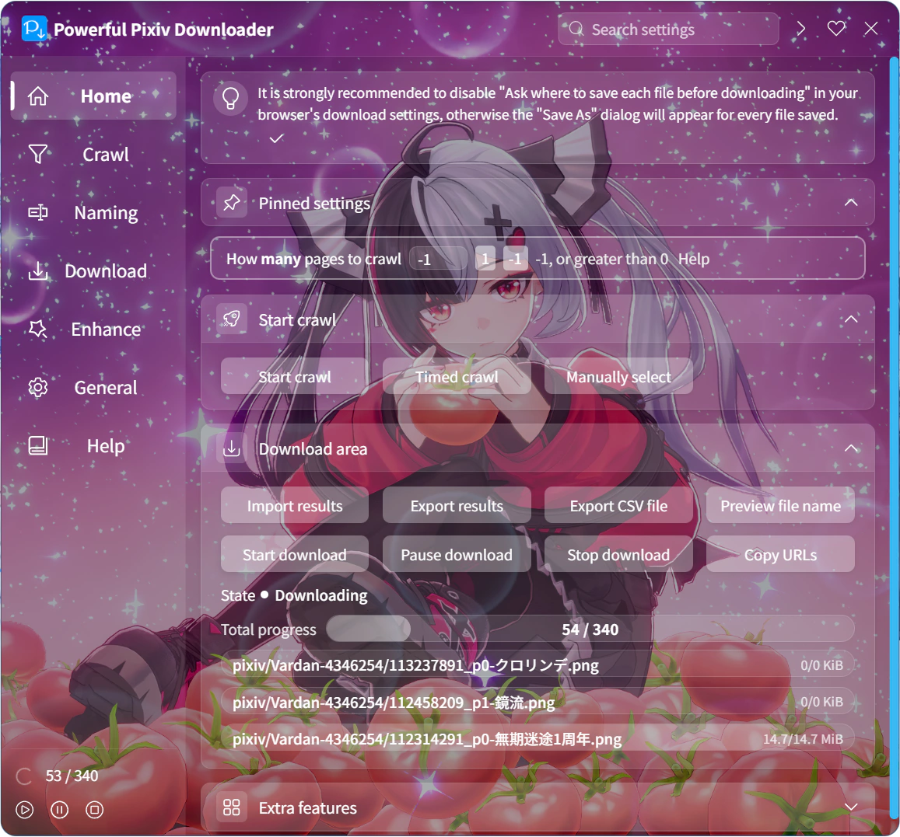

You can set a favorite image as the downloader's background image and adjust its transparency and alignment.

The effect is shown below:

?> The downloader does not include built-in background images, so you need to select one yourself.

This setting includes buttons and options:

### Select File

Clicking this button opens a file selection dialog, allowing you to choose an image as the background.

?> Supported image formats: `.jpg, .jpeg, .png, .bmp, .webp`.

### Clear

Clicking this button removes the downloader's background image, restoring it to no background.

### Alignment

- `Center`: Aligns the center of the background image with the center of the settings panel. If the image's height exceeds the panel's height, the top and bottom may be cropped.
- `Top`: Default. Aligns the top of the background image with the top of the settings panel. If the image's height exceeds the panel's height, the bottom may be cropped.

You can adjust the alignment based on the specific image for a better display effect.

### Opacity

You can use this slider to adjust the background image's opacity. The default is `75%`.

?> There is a black background layer beneath the background image, and the image is semi-transparent by default, making it appear darker. This design ensures the text on the settings panel is readable. Adjusting opacity essentially controls how much the background image obscures the black background.

Increasing opacity makes the image closer to its original appearance; decreasing it darkens the image.
