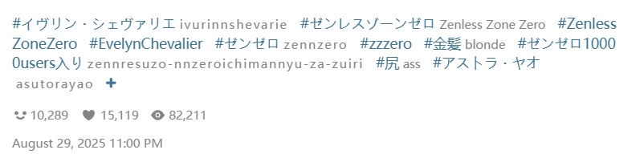
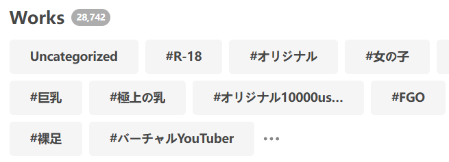

Click this button, and the downloader will crawl all uncategorized works in your bookmarks and add tags to them.

When using this feature, the button displays progress information, for example:

<button id="addTagToUnmarkedWork" type="button" class="hasRippleAnimation settingsPanelActionBtn" data-btn-emphasis="secondary" data-btn-intent="brand" disabled="disabled">2 / 1330</button>

?> To stop this task after it starts, you need to close the current page.

**Additional Notes:**

- This feature crawls **all** uncategorized works; you cannot set a limit on the number to crawl.
- The downloader adds **the work's own tags** to uncategorized works, i.e., the tags visible on their work page, for example:

**What are uncategorized works?**

When adding bookmarks, you can optionally add tags (custom or otherwise). However, clicking Pixiv's bookmark button does not add tags by default.

"Uncategorized works" are bookmarks without any tags.

?> Tags in your bookmarks are independent of the work's own tags. If a work has 10 tags but you didn't add any when bookmarking it, it's considered an "uncategorized work."

**Trivia:** On your bookmark page, Pixiv displays a list of tags, such as:

These are the tags associated with bookmarked works, sorted by frequency.

A special tag, `未分類`, includes all uncategorized works (this tag name is fixed).
