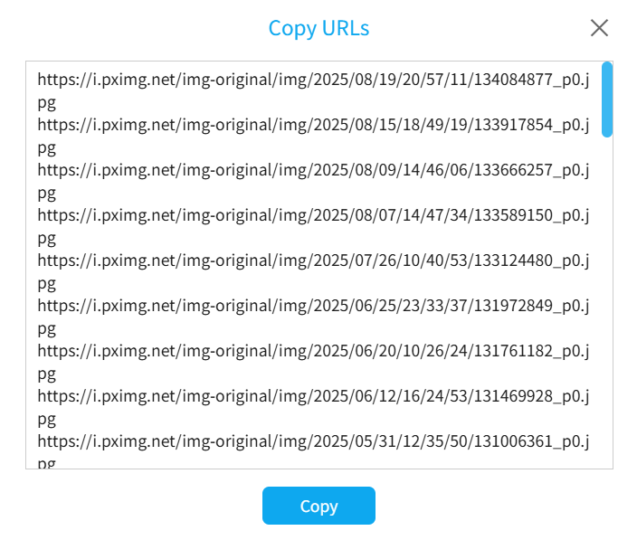

Clicking this button outputs the URLs from the crawl results. It looks like this:

Click the "Copy" button to copy the content to the clipboard.

If needed, copy the URLs and use other download software to download them.

**Note:**

The downloader only outputs URLs for images in the crawl results. Other cases are explained below:
- For Ugoira works, the output URLs are for their original files (Zip files). Although the downloader can convert Ugoira to other formats (e.g., WebM video), converted files are dynamically generated and lack URLs for other software to download.
- Novels have no URLs, so the downloader does not output novel URLs. Pixiv's servers do not store TXT files for each novel. The downloader generates novel files dynamically based on content, so no URLs are available for other software.
- Some files are not in the crawl results, so their URLs are not output. This includes two cases: 1. Some functions generate additional files, e.g., saving work descriptions or metadata, created dynamically during downloading. 2. Novel cover images or embedded images are not independent crawl results but auxiliary data for novels.

?> If there are too many crawl results, for performance reasons, the downloader saves the output to a TXT file in the browser's download directory.
