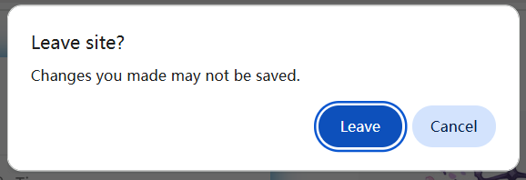

Crawls the selected works. The downloader retains the selected works.

After selecting the works you want to crawl, click the `crawl selected works` button to crawl and download them.

-----------

**Tips:**

- If needed, you can click `Pause selection` and `Continue selection` to make multiple selections. The downloader does not clear previously selected works, so selections accumulate.
- Press the `Esc` key to exit manual selection mode.
- If works are selected, the downloader displays the number of selected works on the `crawl selected works` button.
- The downloader's filter conditions also apply to manually selected works, so some works may be excluded during crawling.
- The downloader does not automatically clear selected works unless you click the `Clear selected works` button.

-------

When navigating to other pages, the selected works list **may** be lost, depending on whether the current page's content is discarded.

For example, navigating from a user profile to a work page without refreshing retains the selected works.

However, navigating to certain pages (e.g., rankings) or refreshing the page discards the current page content. In such cases, the downloader prompts the browser to display a confirmation dialog, as shown below:

If you choose to leave the page, the selected works are lost. If you cancel the navigation, the selected works are retained.

In short, you don't need to worry about accidentally losing selected works, as you'll have the opportunity to choose.
