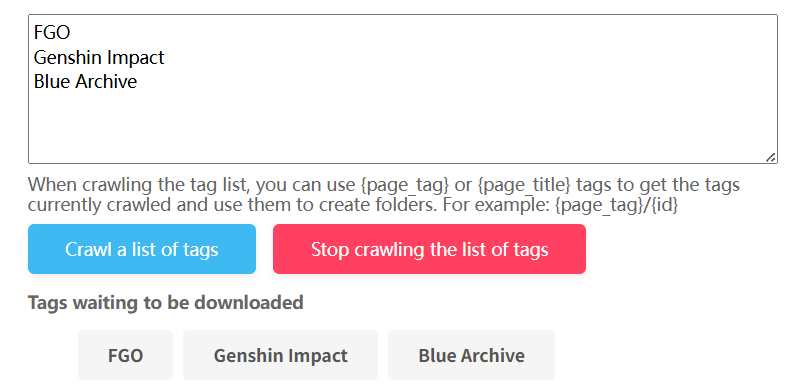

Clicking this button displays an input area at the top of the page. You can enter multiple tags, and the downloader will crawl works for each tag sequentially and download them automatically.

Example:

**Tips:**

- Separate multiple tags with newlines (one tag per line).
- The downloader crawls and downloads each tag's works sequentially. It moves to the next tag after finishing the current one.
- To save each tag's works to corresponding folders, use the `{page_tag}` tag to capture the current tag for folder creation. Refer to the naming rule: `{page_tag}/{id}`.
- Current crawl conditions apply when crawling each tag's works.
- Do not navigate to other pages while crawling a tag list (avoid clicking links on the page).
- During tag list crawling, the downloader does not display crawled works on the page, so you cannot preview results.
- The downloader saves the task state. If the page or browser is closed before completion, reopening the page allows the downloader to resume crawling the remaining tags.

------

On illustration and manga search pages, there are also buttons that can filter the crawl results. After crawling is complete, you can click these buttons to remove unwanted works from the crawl results.
