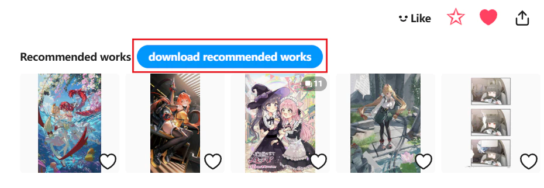

After clicking the bookmark button, Pixiv displays recommended works, and the downloader shows this button, as illustrated below:

Click this button to crawl recommended works.

You can set how many recommended works to crawl in the first crawl condition, `How Many Works to Crawl`. The default value `-1` crawls all recommended works.

?> Recommended works are limited to a maximum of 20.
