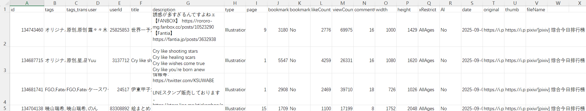

Clicking this button exports the current crawl results as a CSV file, saved to the browser's download directory.

The file content may look like this:

**Tips**:
- The purpose of exporting a CSV file is to allow users to view key data for each work and manipulate the data.
- A multi-image work may generate multiple files during download but is represented by a single record in the CSV file (using the first image's data) to avoid redundant data.
- The exported CSV file **cannot** be used to import crawl results. To import crawl results, use the JSON file exported by the "Export results" button.
- If you only have a CSV file and want to download the works, copy the work IDs from the `id` column and use the [button:crawlById] function on the Pixiv homepage to re-crawl those works.
- To make the downloader automatically export crawl results after crawling, use the [setting:30] function.
