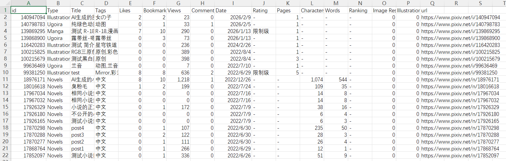

Click this button, and the downloader will retrieve the analytics data from the current category and export it as a CSV file, saving it to the browser's download directory. An example of the file content is as follows:

