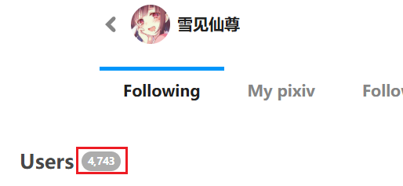

Clicking this button makes the downloader crawl user data from the current subpage (followed users, friends, or fans) and generate a CSV file, saved to the browser's download directory.

You can export your own following list as a backup for future needs.

?> Although the button says "followed users," it can also export friends and fans lists.

?> The number of users crawled depends on the "How Many Pages to Crawl" setting. Each page has up to 24 users.

?> This function only crawls user lists, not works.

The CSV file contains the following data for each user:

- User ID
- Username
- User profile URL
- User description
- User avatar image URL

**Note:** The number of users exported by the downloader may be less than the number displayed on the webpage. This is not a bug, but because some users have already deactivated their accounts, so the downloader cannot retrieve their data.

For example, my following page shows 4,743 users:

Some users have already deactivated, but Pixiv does not subtract them from the total count, which can be somewhat misleading. However, you might notice clues: usually, 24 users are displayed per page, but some pages may have only 23 or fewer users, which is because some users no longer exist.

The downloader is more likely to observe this situation when crawling data: the downloader requests 100 users' data each time, but Pixiv often returns more than 90 users. After crawling is complete, the downloader only obtained data for 4,668 users, which is 75 less than the number displayed by Pixiv. As for the deactivated users, I cannot retrieve their data.
