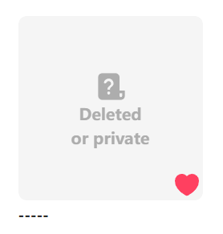

Your bookmarks may include works that are no longer available, which you cannot view or download. For example:

Click this button, and the downloader crawls your bookmark list (without fetching detailed data for each work, so it's relatively quick). It then identifies **all** deleted works and exports their ID list to the download directory, for example:

This feature is useful for some users, as work IDs can help locate archived versions of these works on other illustration websites.

?> The downloader exports only work IDs, as other data (e.g., user IDs) for deleted works is invalid and set to meaningless values by Pixiv.

?> When using this feature, the downloader displays progress information in the log at the top of the page. The work count in the log, e.g., "Currently 1585 works," refers to the number of deleted works detected.
