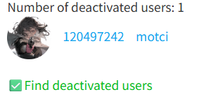

You can find deactivated users in your following list.

**How it works:**
- Since the launch of this feature (March 2026), when you use the downloader, it will retrieve your following list once and save data for all users, including ID, username, and avatar. This data is saved locally and will be automatically cleared by the browser when you remove the downloader.
- Later, when you click this button, the downloader will retrieve your following list again and compare it with the previously saved historical data to find which users are now missing compared to before.
- The downloader retrieves data for these users one by one and checks if they have been deactivated. The downloader will display progress information in the top log.
- After the check is complete, it displays the results. If there are deactivated users, the downloader will output their list, which might look like this:

**Note:**
This feature cannot find users who deactivated before; it can only find users who deactivated after the downloader saved the historical following data.
