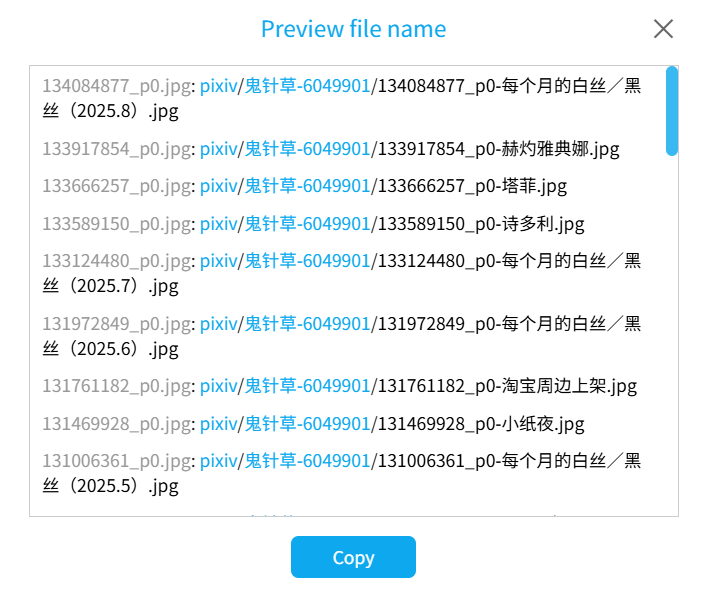

Previews the file names for each crawl result. It looks like this:



The downloader generates a line of text for each crawl result in the format: `Default file name: File name generated by naming rule`, for example:

<p class="result"><span class="color999">134084877_p0.jpg</span>: <span class="colorFolder">pixiv</span>/<span class="colorFolder">鬼针草-6049901</span>/<span class="color000">134084877_p0-Monthly White Silk/Black Silk (2025.8).jpg</span></p>

?> Blue text in the file name indicates a folder.

You can click the "Copy" button, and the downloader will copy the content to the clipboard.

?> If there are too many crawl results, for performance reasons, the downloader saves the output to a TXT file in the browser's download directory.

This function is useful for previewing file names and creating renaming scripts.

If you previously downloaded files and want to rename them to match the downloader's naming rules, crawl them first and copy the content from "Preview file name". Modify the left side to the old file names and the right side to the new file names (possibly removing the folder part) to create renaming commands.

For example, on Windows, copy a preview result like this:

<p class="result"><span class="color999">134084877_p0.jpg</span>: <span class="colorFolder">pixiv</span>/<span class="colorFolder">鬼针草-6049901</span>/<span class="color000">134084877_p0-Monthly White Silk/Black Silk (2025.8).jpg</span></p>

Modify it to:

```
ren old_name.jpg 134084877_p0-Monthly White Silk/Black Silk (2025.8).jpg
```

Execute this command in the file's directory to rename the file.

?> For batch editing, use an editor with multi-line editing mode (e.g., VS Code) to improve efficiency.
