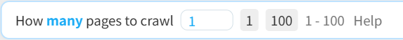

On some pages, new works may appear over time, such as:

- User profile
- New works by followed users
- Everyone's new works
- Your bookmark page
- Search page

On these pages, if you want to crawl new works periodically and download them automatically, you can use the timed crawl function.

**Example:**

To schedule crawling of new works by followed users, follow these steps:

1. Open the [Works by Followed Users](https://www.pixiv.net/bookmark_new_illust.php) page.

2. Set the number of pages to crawl each time:

This page count should consider the "interval time." For example, if you want to crawl every 30 minutes and the page's new works in 30 minutes do not exceed 1 pages, set it to `1`.

3. Click the `Timed crawl` button, and the downloader displays an input box to set the interval time:

Interval time for timed crawl (minutes)

<input class="XZInput w100" placeholder="" type="text" value="30"><button class="XZInputButton hasRippleAnimation">
      Submit
      
    </button><button class="XZInputButton cancel hasRippleAnimation">
      Cancel
      
    </button>

The default value is 30 minutes, which you can adjust as needed.

Click the `Submit` button, and the downloader starts the timed crawl task, displaying a prompt in the log:

Timed crawl started, interval: 30 minutes. To modify the interval, adjust the setting in the "More" tab: Timed crawl interval. 

**Tips:**

- The downloader does not start crawling immediately; it waits until the set interval before the first crawl.
- It's recommended to enable the [setting:63] function in the "More" tab to avoid unnecessary duplicate downloads.
- The interval should not be too short, as crawling and downloading take time.

-----------

When using timed crawl, note the following:

1. Do not close the current tab. You can switch to other tabs and continue using the browser.
2. Do not change the URL of the current tab. For example, if you're on a user profile performing timed crawl and click a work to enter its page, the task will be canceled.
3. Enable the [setting:63] function to avoid downloading duplicates.
4. If the extension updates automatically, the page may not download files correctly (refresh the page to restore functionality). For long-term timed crawl, consider installing the extension offline to avoid interruptions from updates. See the [Offline Installation](/en/Installation/OfflineInstallation?id=offline-installation) page.
5. Set a lower page count to avoid crawling too many duplicate works. For example, on a search page, you can crawl up to 1000 pages, but it's unnecessary to crawl all of them. Setting 10 pages or fewer is fine if new content within the interval doesn't exceed 10 pages.
6. On search pages, crawled works are not displayed on the page (i.e., no preview of search results).
7. When clicking the `Timed crawl` button, the downloader prompts for the interval time, which syncs with the [setting:29] setting.
8. The downloader uses the interval set at the task's start. Changing the interval later does not affect the ongoing task. To apply a new interval, click `Cancel timed crawl`, then click `Timed crawl` to start a new task with the updated interval.
