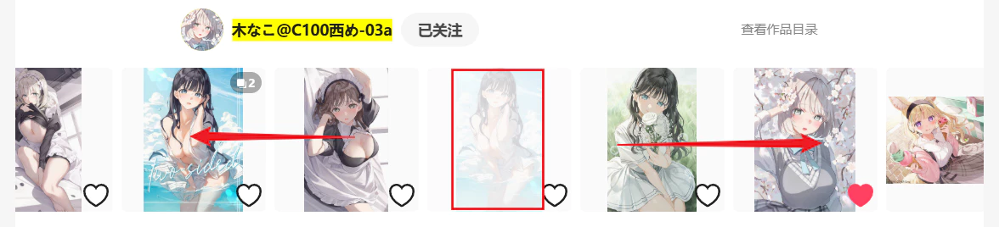

Clicking this button makes the downloader crawl the current work and works newer than it.

You can set how many works to crawl (including the current work) in the first crawl condition, `How Many Works to Crawl`. The default value `-1` crawls the current work and all newer works.

--------

"Newer works" are works with a posting time later than the current work. On a work page, they are located to the left of the current work.

Diagram:

Newer works are on the left, older works on the right.
