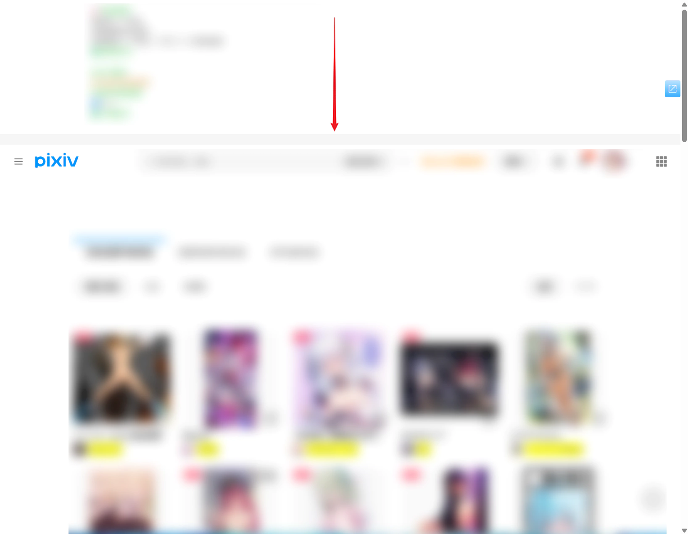

当下载器在页面顶部输出日志时，你可以控制日志区域默认显示还是隐藏。默认值是 `显示`。

两种方式有何区别呢？

如果你经常需要查看日志，那么选择 `显示` 会更方便。但这种方式会在特定情况下影响浏览体验：如果页面尚未滚动，那么下载器显示日志区域之后会导致页面内容向下移动。示意图：

如果页面本来就向下滚动了一些距离，那么就不会有这个影响（页面内容不会向下移动）。

如果你不希望日志区域打扰到你，可以选择 `隐藏`，这样不会导致上面的问题。

PS：不管选择哪种方式，当你想查看日志时，都可以按快捷键 `L` 来显示日志区域。
