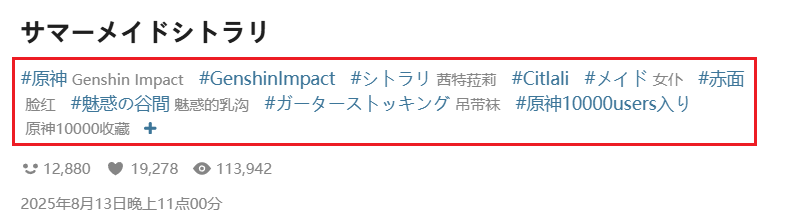

你可以要求作品必须包含某些标签。没有这些标签的作品不会被抓取。

?>标签（tag）指的是作品简介下方的 Tag 列表，例如：

**提示：**
- 你可以添加多个标签，中间用**英文逗号** `,` 分割。
- 不区分大小写。下载器会使用你设置的标签与作品的标签逐个进行对比。
- 全字匹配。如果你设置了 `ab`，就只会匹配到 `ab`，不会匹配到 `abc`。反之亦然。
- 匹配模式：`全部` 指作品里必须含有你设置的所有标签；`任一` 指作品只需要含有你设置的任意一个标签。
- 下载器会把原始标签和翻译后的标签一起检查。如果原始标签里没有你设置的标签，但翻译后的标签里含有你设置的标签，那么下载器就会认为这个作品含有这个标签。
- 根据你在 Pixiv 使用的语言不同，Pixiv 会返回不同的翻译标签。例如 `巨乳` 的英语翻译是 `large breasts`，韩语翻译是 `거유`。所以下载器在检查翻译后的标签时，也只会检查当前语言里的翻译后的标签。
- 推荐优先使用原始标签，这样在某些场景里可以更早执行检查。
