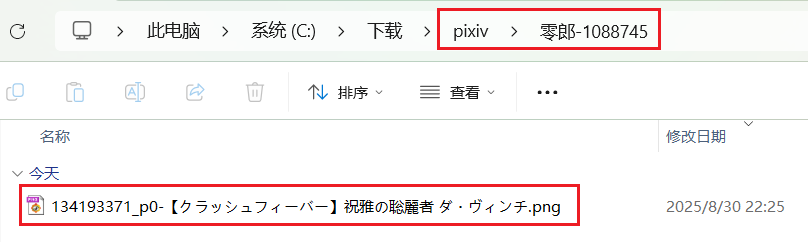
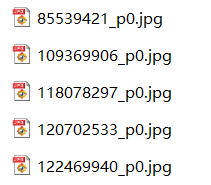
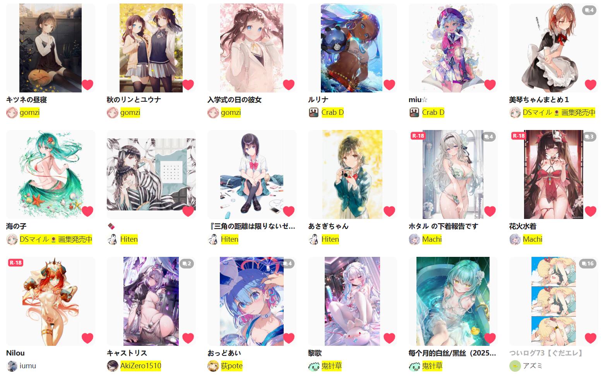
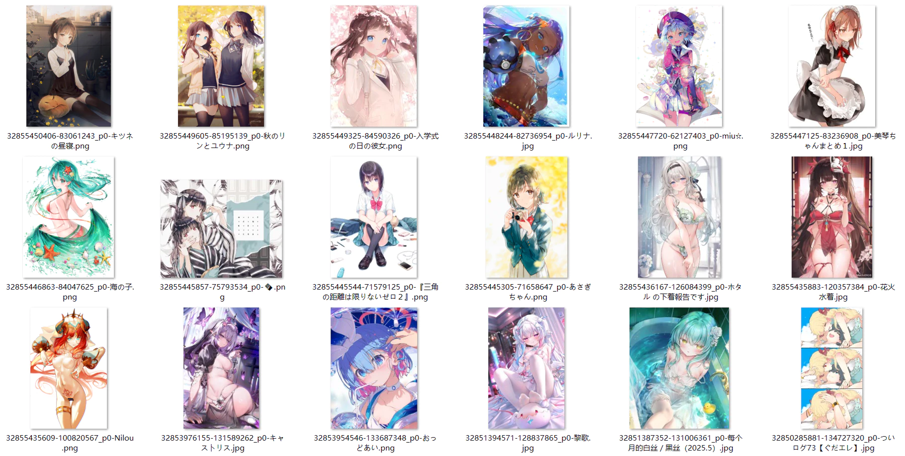
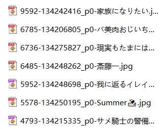
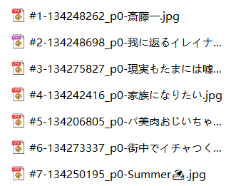

这是很重要的功能，你可以在这里设置下载器保存的**文件名**，也可以**建立文件夹**来分类。

下载器在保存文件时会替换命名规则里的标记并生成文件名。例如 `{id}` 会被替换成作品 ID，形式如 `75863159_p0`。

?> 你可以根据需要修改命名规则。只有 `{id}` 是必须的，因为它是每个文件的唯一标记。

**一些功能按钮：**

`保存` 按钮可以保存当前命名规则；`加载` 按钮则会显示保存过的命名规则。使用这两个按钮，你可以保存多个常用的命名标记，并方便的切换。

`提示` 按钮：点击它可以查看所有标记及其说明。不过这里是 Wiki，所以没有效果。

下拉选择框：点击它会显示所有标记，点击一个标记即可把它插入到光标位置。不过这里是 Wiki，所以没有效果。

### 建立文件夹

你可以使用斜线 `/` 建立文件夹。有需要的话，可以使用多个斜线`/` 建立多层文件夹。

默认的命名规则 `pixiv/{user}-{user_id}/{id}-{title}` 会建立两层文件夹：
- 先建立 `pixiv` 文件夹
- 在里面建立用户名和用户 ID 的文件夹
- 在里面保存作品，文件名为作品 ID 和标题。

效果示例：



?>`/` 并不是必须的，如果你不想建立文件夹，也可以不使用 `/`。例如把命名规则设置为 `{id}` 的话，文件会直接保存到浏览器的下载目录里，不会建立子文件夹。

### 附加说明

- 你可以使用多个标记；多个标记之间建议添加分割符号，如 `{id}-{tags}-{user}`，以免多个标记的内容挨在一起，难以分辨。分割符号没有固定要求，随你喜欢就好。
- 除了预设的标记，你也可以输入自定义文字，例如 `标题 {title} 标签 {tags}`。这些非预设标记的文字会原样保留。
- 没有后缀名标记，因为后缀名是下载器自动添加到文件末尾的。
- 如果生成的文件名里含有不能作为文件名的特殊字符，会被替换成近似的全角符号。例如一些标签里含有斜线 `/`，但斜线不能用在文件名里，所以下载器会把它替换成全角的 `／`。
- 如果你使用了 `{tags_translate}`，就没有必要使用 `{tags}`，因为前者包含它。翻译的内容根据你在 pixiv 的语言设置有所不同。例如，如果你的 pixiv 界面是中文的，那么标签的翻译一般也是中文的。
- `{tags_transl_only}` 只保存翻译后的标签，不保存原本的日文标签。但是如果某个标签没有翻译，则会保存原本的日文标签。
- 文件名里必须要含有作品的**唯一标记**，用于防止文件名重复。文件名重复会导致下载的文件互相覆盖，或者出现另存为窗口。
- 默认命名规则里的 `{id}` 就是唯一标记。有些用户可能想去掉 `{id}`，使用 `{pid}` 和 `{p}` 代替。这是可以的，但必须同时使用，也就是同时包含 `{pid}` 和 `{p}`，不能只使用其中一个。这是因为多图作品里有多张图片，它们的 `{pid}` 是相同的，必须加上 `{p}` 才能使它们的名字不同。
- `{bmk_1000}` 不会显示具体的收藏数量，而是以 1000 为计算单位，显示一个整数，并在最后显示一个加号 `+`（1000 以下会显示为 `0+`）。这样可以让收藏数显得不那么杂乱。
- 保存文件时，如果已存在同名文件，下载器会让浏览器覆盖文件，而不是在后面添加序号。PC 上的浏览器都会这样做，但是 Android 上的 Edge canary 不会覆盖旧文件，而是会添加序号。
- 文件名的长度有可能会超出操作系统允许的长度限制。这经常是由于文件名里含有作品的标签导致的，比如 `{tags}`。如果文件名超长，这个文件可能无法自动保存，此时浏览器会弹出另存为对话框，让用户手动操作。如果你遇到了文件名超长的问题，可以启用下载器的“更多”标签页里“命名”分类下的“文件名长度限制”功能。
- 当文件名超长时，浏览器可能会自动截断超出的部分，使文件可以正常保存。但这是分情况的。据我所知，Windows 上的 Chrome 浏览器会这样做，但 Linux 和 Android 上的浏览器可能不会这样做。另外如果你把文件保存到远程位置（如网络驱动器），浏览器可能也不会截断文件名（即便是 Chrome 也会如此）。

`{page_type}`（页面类型名称）目前有这些值：

```
Unsupported, Home, Artwork, UserHome, BookmarkLegacy, Bookmark, ArtworkSearch, AreaRanking, ArtworkRanking, Pixivision, BookmarkDetail, NewArtworkFromFollowing, Discover, NewArtworkFromAllUsers, Novel, NovelSeries, NovelSearch, NovelRanking, NewNovelFromFollowing, NewNovelFromAllUsers, ArtworkSeries, Following, Request, Unlisted, DiscoverUsers, Dashboard, Contest, SearchUsers
```

### 一些示例

#### 去掉 {id} 里的 p 标记

`{id}` 带有序号，例如 `44920385_p0`。如果你想移除 `_p`，可以把 `{id}` 替换为 `{pid} {p}`，这样生成的字符是 `44920385 0`。

?>注意：如果你想替换 `{id}`，那么命名规则里必须同时含有 `{pid}` 和 `{p}`，这是为了防止文件名重复。

#### 去掉每个作品第一张图片里的序号

如果你觉得第一张图片不需要序号，想把 `44920385_p0` 变成 `44920385`，可以启用 [setting:47] 的选项。

#### 其他人使用的命名规则

以下是一些用户使用的命名规则，你可以参考：

```
{user}/{title}{id}
{user}/{title}{date}/{id}
{user_id}_{user}/{type}/{date} {title}/{id}
{user_id}-{user}/{title}-{id}
{user} (id={user_id})/{id}
{user} {user_id}/{id} {title} {upload_date}
{user}_{date}_{title}_{id}
{id}_{title}_{user_id}_{user}
{id}{user}-{user_id}-{title}{tags}{tags_translate}{page_tag}-{like}-{bmk}-{upload_date}
```

**注意：**最后一个命名规则不是个好主意，因为它生成的文件名很容易超长（大于 256 个字符），并导致文件名被截断，所以实际的文件名可能只有前半部分。

有些作品的标签列表字数很多，所以在文件名中使用 `{tags}`、`{tags_translate}`、`{tags_transl_only}` 的话可能会导致文件名超长。如果你想使用这些命名标记，建议把它们放在文件名的末尾，以避免其他命名标记的内容被截断。

### 使用命名标记排序

有些命名标记是有规律的，如果把它们设置为文件名的**第一部分**，就可以在资源管理器里按文件名排序。

#### 反映时间顺序的标记

在大部分页面里，作品都是按照作品 ID 倒序排序的。越晚发表的作品，其 ID 越大，并且显示在最前面。

`{id}`（作品 ID）是递增的。在文件名的开头使用 `{id}`，并把文件按照 ID 大小倒序排序，就可以使其与网页上显示的顺序一致。例如：



`{date}`（作品发布时间）也有类似的作用。

--------

`{bmk_id}` 可以反映你收藏作品的时间顺序。把它放在文件名开头，如 `{bmk_id}-{id}`，并按文件名倒序排列，就可以让你文件顺序与你的收藏保持一致。

例如这是网页上的顺序：



这是使用 `{bmk_id}` 排序的效果：



#### 反映数量多少的标记

有些标记是数字，例如 `{like}`、`{view} `、`{bmk}`、`{bmk_1000}`、`{rank}`。

示例：把作品按照 `{bmk}`（收藏数量）顺序倒序排列，可以把高质量作品排在前面：



示例：在排行榜页面里下载时，可以按照 `{rank}` 顺序：


