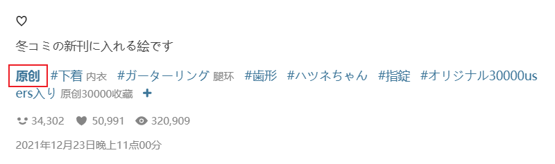
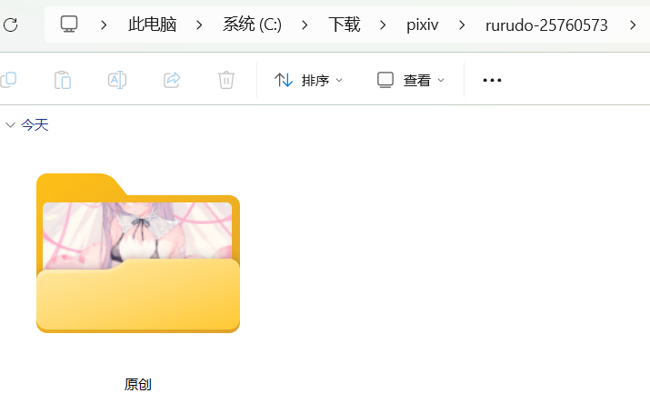

如果你想在作品里含有特定标签时建立一层特殊文件夹，可以启用这个设置。

例如：作品 [94964157](https://www.pixiv.net/artworks/94964157 ':target=_blank') 含有“原创”标签：

如果你在这个设置里输入了 `原创`，下载器就会建立“原创”文件夹存放这个作品：

**使用方法：**

首先在这个设置里输入目标标签，如果有多个标签，使用英文逗号 `,` 分割。注意：在这里只需要输入目标标签，不要填写完整的命名规则。

你可以设置 2 个标签列表：`{match_tag_folder1}` 和 `{match_tag_folder2}`。这是为了处理一个常见的需求：如果一个角色属于某个作品，就建立两层文件夹：第一层是作品名字，第二层是角色名字。例如我在 `{match_tag_folder1}` 里设置作品名字 `GenshinImpact`，并在 `{match_tag_folder2}` 里设置角色名字 `フリーナ`。如果一个作品同时含有这两个标签，下载器就可以为这个作品添加两层文件夹：`GenshinImpact/フリーナ/`。

当然，如果你没有这个需求的话，可以只使用第一个标签列表。

在你设置标签列表之后，还需要修改“命名 / 文件夹和文件的名字”里的“命名规则”设置，在需要的地方插入特定标记和斜线来添加一层文件夹。`/{match_tag_folder1}/` 代表第一个标签列表的匹配结果，`/{match_tag_folder2}/` 代表第二个标签列表的匹配结果。

示例：`pixiv/{match_tag_folder1}/{match_tag_folder2}/{id}`

**匹配方式：**

下载器会在作品的标签列表里查找你设置的标签，并且会优先使用标签别名。

匹配模式是完全一致，不区分大小写。如果你设置了 `A`，可以匹配到 `a` 或者 `A`，但不会匹配到 `abc`。

对于你设置的每个标签列表，下载器都会按顺序查找：先查找你设置的第一个标签，如果找不到就查找第二个，以此类推。一旦找到第一个匹配的标签，就停止查找，并用它替换命名规则中的对应标记：`{match_tag_folder1}` 或 `{match_tag_folder2}`。

如果没有匹配到你设置的标签，下载器会忽略对应的标记。

使用这个设置，你可以对含有特定标签的文件进行单独的分类。

**使用标签别名来统一文件夹名字：**

有些标签有多种变体，例如 `GenshinImpact` 有这些变体：`GenshinImpact,Genshin Impact,Genshin,原神,原神インパクト`。如果你想把这些标签都视为 `GenshinImpact`，并且只建立 `GenshinImpact` 文件夹（而不是使用变体来建立多个不同的文件夹），就可以使用该设置下方的“标签别名”功能。

把这些变体的别名设置为 `GenshinImpact`，然后在这个设置里只需要使用 `GenshinImpact` 即可匹配到所有变体。
