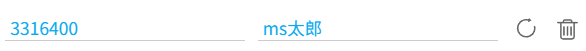

你可以在这里添加用户的 ID，并为其设置一个名字。这会影响 `{user}` 命名标记。

例如 https://www.pixiv.net/users/3316400 的用户名是 `MだSたろう`，如果我想为他设置一个自定义名字，可以输入用户 ID 为 `3316400`，用户名为自定义的 `ms太郎`，然后保存。

当我下载他的作品时，`{user}` 会忽略他原本的名字，输出我设置的名字 `ms太郎`。

当你添加一条规则之后，下载器会这样显示：

如果有需要，你可以在这里修改设置（例如修改用户名），然后点击右侧的刷新按钮来更新这条规则。你也可以删除这条规则。

-----------

**使用场景 1：**防止用户改名。

有些用户可能会经常改名，如果你想使用他原来的名字，可以在这里手动设置他的名字。

常见的情况是用户名后面有 @ 符号，例如：

- Anmi@画集発売中
- 奥馬@skeb募集中
- さしみなす@依頼募集中

虽然前面的 [setting:50] 功能可以解决此问题，但是有些用户的名字里可能不使用 @，例如：

- いの字/inoji
- 焔すばる★２日目 東C17a
- 送り萬都 🔞仕事募集中
- しりー＊C99木曜東A21b
- ショーンC99木東ユ40b
- オムレットマト西ぬ31b

你可以在这里为他们设置一个固定的名字。

-----------

**使用场景 2：**为用户设置别名，也就是昵称。

例如一个用户的名字是日语，但我不会输入日语，不方便在本机上搜索。如果我为他设置一个中文别名（或者我能够使用的其他语言），就可以方便的搜索了。

如果一个用户的名字很难记住，你也可以为他设置一个容易记住的别名。
