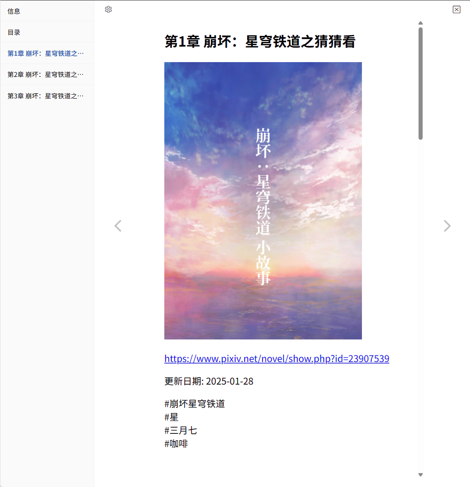
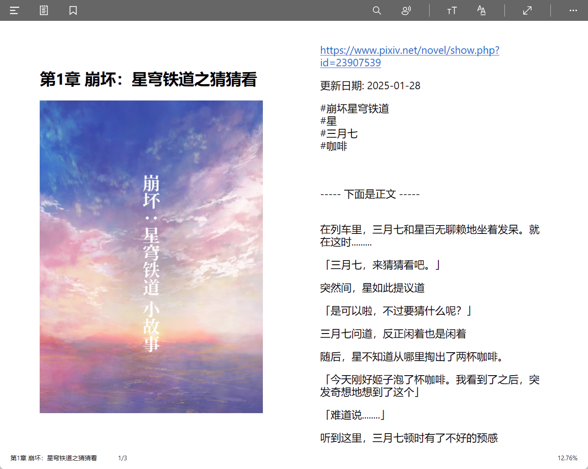
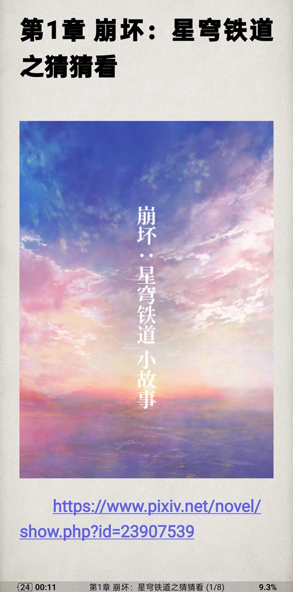

你可以选择把小说保存为 TXT 或者 EPUB 格式。默认格式是 EPUB。

EPUB 是电子书的格式，可以显示富文本样式，支持章节目录，并且可以在内部保存封面图片和插图。

?> 下载器生成的 EPUB 文件是 EPUB `2.0` 标准。有些软件不能正确打开它，例如 WPS。请使用小说阅读器打开。

PS：相比 EPUB 格式，TXT 格式存在一些缺点：
- TXT 文件的内容是纯文字，不能显示富文本样式（例如文字样式、超链接等）。
- TXT 文件里没有统一的标题级别标记，当含有多篇小说（即多个章节）时，很多阅读器都不能正确识别章节格式。
- TXT 文件无法保存小说里的插画，所以只能把图片保存成单独的文件。有时一个 TXT 文件可能有十几个相关图片，非常杂乱。

### 一些小说阅读器

**在线阅读**：https://epub-reader.online/

**Windows**：Aquile Reader

你可以从 Microsoft Store 安装它。

**Android**：（静读天下）Moon+ Reader

