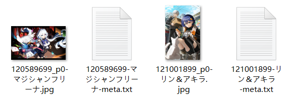

下载器在下载时，可以为每个作品生成一个文件来保存它的一些数据。

示例：



?> 元数据的文件名的末尾有 `meta` 标记。

### 作品类型

分为`插画`、`漫画`、`动图`、`小说`。

如果下载的文件类型符合你勾选的类型，下载器才会为它创建元数据文件。

?> 小说作品有一个单独的设置用于保存元数据：[setting:68]，它会在小说的开头保存一些元数据，无须创建单独的 TXT 文件，使用起来更方便。但是它所保存的元数据比较少。如果你已经启用了“在小说里保存元数据”，通常就不需要在这里为小说保存元数据文件。

### 文件格式

有两种格式可以选择，并且可以都选中：
- `TXT` 格式易于阅读，但只包含比较常用的数据。
- `JSON` 格式是下载器的内部数据，保留了更多的数据。

#### TXT 格式

对于图像作品（插画、漫画、动图），下载器保存的元数据示例如下：

```
ID
120589699

URL
https://www.pixiv.net/i/120589699

Original
https://i.pximg.net/img-original/img/2024/07/16/19/51/00/120589699_p0.jpg

Thumbnail
https://i.pximg.net/c/250x250_80_a2/custom-thumb/img/2024/07/16/19/51/00/120589699_p0_custom1200.jpg

xRestrict
AllAges

AI
No

User
愛田乃彩

UserID
91879154

Title
マジシャンフリーナ

Description
(Twitter) https://twitter.com/aida_noa_
無断転載・使用禁止/All rights reserved.

Tags
#原神
#GenshinImpact
#フリーナ
#Furina
#女の子
#イラスト

Size
4096 x 2537

Bookmark
814

Date
2024-07-16T10:51:00+00:00
```

小说的 TXT 元数据文件里的内容大致相同，但是没有 `Original` 和 `Size`。此外，小说的 `Thumbnail` 就是它的封面图片的 URL。

#### JSON 格式

JSON 文件的内容是下载器的内部数据（即该作品的抓取结果）。如果你想知道各个属性的含义，可以查看源代码里的注释（只有中文）：[StoreType.d.ts](https://github.com/xuejianxianzun/PixivBatchDownloader/blob/master/src/ts/store/StoreType.d.ts)。

JSON 格式的元数据文件内容示例如下：

```json
{
  "aiType": 1,
  "idNum": 120589699,
  "id": "120589699_p0",
  "original": "https://i.pximg.net/img-original/img/2024/07/16/19/51/00/120589699_p0.jpg",
  "thumb": "https://i.pximg.net/c/250x250_80_a2/custom-thumb/img/2024/07/16/19/51/00/120589699_p0_custom1200.jpg",
  "regular": "https://i.pximg.net/img-master/img/2024/07/16/19/51/00/120589699_p0_master1200.jpg",
  "small": "https://i.pximg.net/c/540x540_70/img-master/img/2024/07/16/19/51/00/120589699_p0_master1200.jpg",
  "title": "マジシャンフリーナ",
  "description": "(Twitter) <strong><a href=\"https://twitter.com/aida_noa_\" target=\"_blank\">twitter/aida_noa_</a></strong><br />無断転載・使用禁止/All rights reserved.",
  "pageCount": 1,
  "index": 0,
  "tags": [
    "原神",
    "GenshinImpact",
    "フリーナ",
    "Furina",
    "女の子",
    "イラスト"
  ],
  "tagsWithTransl": [
    "原神",
    "GenshinImpact",
    "フリーナ",
    "Furina",
    "女の子",
    "イラスト",
    "芙宁娜",
    "女孩子",
    "插画"
  ],
  "tagsTranslOnly": [
    "原神",
    "GenshinImpact",
    "芙宁娜",
    "Furina",
    "女孩子",
    "插画"
  ],
  "user": "愛田乃彩",
  "userId": "91879154",
  "fullWidth": 4096,
  "fullHeight": 2537,
  "ext": "jpg",
  "bmk": 868,
  "bookmarked": false,
  "bmkId": "",
  "date": "2024-07-16T10:51:00+00:00",
  "uploadDate": "2024-07-16T10:51:00+00:00",
  "type": 0,
  "rank": null,
  "ugoiraInfo": null,
  "seriesTitle": "",
  "seriesOrder": null,
  "seriesId": null,
  "novelMeta": null,
  "likeCount": 452,
  "viewCount": 4703,
  "commentCount": 3,
  "xRestrict": 0,
  "sl": 2
}
```
