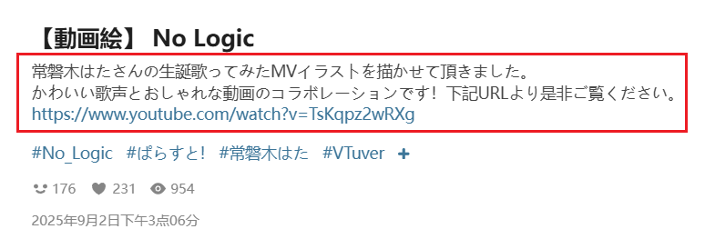
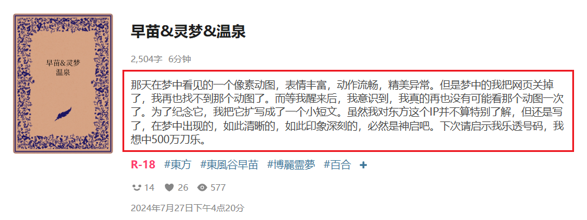
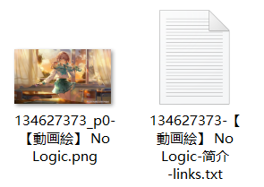

如果你启用了这个功能，下载器会为每个作品创建一个 TXT 文件，保存它的简介。

作品的简介指标题下面的介绍文字。例如：





下载器保存的 TXT 简介文件：



TXT 简介文件的文件名里可能有 2 个标记：
1. 必定有`简介`标记。这个标记由下载器的语言设置决定，例如使用英语时，该标记是 `description`。
2. 如果简介里含有网址链接，下载器会添加 `links` 标记。

?>有些作品没有简介，此时下载器不会为其创建 TXT 简介文件。

这个设置有两个子选项，并且可以同时启用：

### 每个作品分别保存

为每个作品创建一个 TXT 简介文件。当你下载多个作品时，下载器会生成多个简介文件。

### 汇总到一个文件

当抓取完成时，下载器会生成一个 TXT 文件，汇总所有作品的简介。

这个文件的**保存位置**有两种情况：

1. 如果汇总文件里的简介数据来自多个不同用户的作品，它会直接保存到浏览器的下载目录里。因为此时它不属于某一个用户，不应该将其放入用户名的文件夹里。

2. 如果简介数据来自同一个用户：
- 如果命名规则里的某个文件夹里含有 `{user}`，下载器会把汇总文件保存到这个文件夹里。对于默认的命名规则，下载器会将其保存到 `pixiv/{user}-{user_id}/` 里。
- 如果命名规则里的文件夹都不包含 `{user}`，下载器会将其直接保存到浏览器的下载目录里。

汇总文件的**文件名**包含多个部分：
1. `简介汇总` 标记，会根据下载器的语言而变化。
2. `user` 标记，附带用户名。只有当汇总文件里的数据全部来自同一个用户时才有这个标记。
3. 当前网页标题
4. 时间和日期

例如：

```
简介汇总-user 飞天卷饼猫-#女の子 星极（重制版） - 飞天卷饼猫的插画 - pixiv-2025／9／2 22：47：38.txt
```
