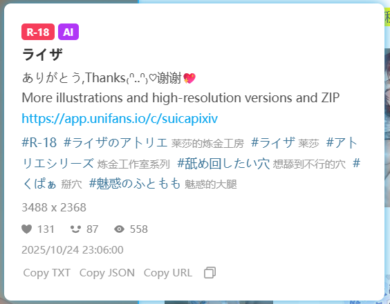

原本我们只能在作品页面里查看详细信息，例如作品的简介、标签列表、浏览数量、点赞数量、收藏数量等。

如果你想不进入作品页面就能查看详细信息，可以启用这个功能。当你把鼠标放在缩略图上时，下载器会显示详细信息，例如：

这个面板上的链接是可以点击的，比如简介里的网址、标签的链接。

如果你想关闭详细信息面板，可以点击它，或者将鼠标移出其边界。

**底部按钮：**

面板的底部有一些按钮：

- `Copy TXT` 点击它，下载器会把一些元数据复制到剪贴板，内容与 [setting:73] 功能生成的 TXT 文件相同。
- `Copy JSON` 点击它，下载器会复制作品的 JSON 数据（未经处理的原始数据）。
- `Copy URL` 点击它，下载器会复制作品的网址。
- `复制按钮` 点击它，下载器会复制作品的第一张图片和文字摘要。
