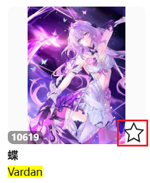

你可以使用这个设置来控制下载器收藏作品时的行为。

**子选项：**

当你使用受此设置影响的功能时，可以设置：

- 是否公开：添加为公开或者非公开收藏
- 是否添加标签

默认值是公开收藏；添加作品的原始标签。

?> 如果一个作品已经收藏过了，你依然可以再次收藏它。这不会改变它的收藏时间（所以也不会改变它在收藏页面里的顺序），但可以更新它的公开状态和标签列表。例如：有个作品之前是公开的，并且添加了标签。如果你有需要的话，可以把这个设置修改为不公开+不添加标签，然后让下载器再次收藏它。

**受此设置影响的功能：**

1. 作品页面里的快速收藏按钮（☆）：

2. 搜索页面里，预览搜索结果时的快速收藏按钮（☆）：

3. 预览作品时，使用快捷键 `B` 收藏作品。
4. 使用图片查看器时，点击底部的按钮（☆）收藏作品。
5. [setting:53] 功能。
6. 在用户主页和搜索页面里，下载器的“更多”标签页里的“收藏本页面的所有作品”功能。

**不受此设置影响的功能：**

1. Pixiv 原本的收藏按钮（心形）不受此设置影响。

2. 收藏页面里的“给未分类的作品添加标签”按钮不受部分设置影响。该功能总是会附带标签（但会根据此设置，使用作品的原始标签或者翻译后的标签）；是否公开则遵从作品之前的收藏状态，也就是不会改变公开状态。
